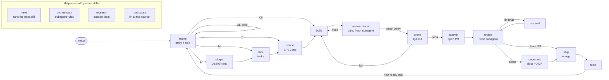

# cultoftheai skills

Agent skills for Claude Code and Codex. They take a request from a raw idea to merged, documented code.

GitHub issues (or Jira or Linear) hold the record of the work. The size of a request (XS to XL) sets how much process it gets. A one-line fix skips the story, the spec and the docs. A large feature gets a design, tasks and an ADR.

## Plugins

| Plugin | Skills | Purpose |
| --- | --- | --- |
| `sdlc` | setup, frame, slice, shape, build, prove, submit, review, respond, document, ship, retro, next, research, root-cause, orchestrator | The delivery workflow. |
| `misc` | create-skill | Writes new skills in the house format of this repository. |

## Install

Claude Code:

```
/plugin marketplace add cultoftheai/skills
/plugin install sdlc@cultoftheai
/plugin install misc@cultoftheai
```

Codex:

```
codex plugin marketplace add cultoftheai/skills
```

Then install `sdlc` and `misc` from `/plugins` and start a new session.

## How we use it

1. Run `/sdlc:setup` once in each repository. It writes `.sdlc/settings.json`, creates the stage and size labels, and adds the scripts.
2. Give a raw request to `/sdlc:frame`. It writes the story and sets the size.
3. Run `/sdlc:next`. It reads where the issue or PR stands and runs the skill that comes next. Add `--run` to continue until a person must act, or `--auto` to skip the questions at each gate.
4. You can also type any skill directly, for example `/sdlc:review 42`. Every skill ends with a `Next:` line that names the command to run after it.

People stay in the loop at these points: they approve the story, approve the PR, and confirm the merge (unless `--auto`). In a solo-maintainer repository, `ship --auto` also counts as the PR approval and records that on the PR.

## Skill order



### What each skill does

| Skill | Use it when |
| --- | --- |
| `setup` | A repository has no `.sdlc/settings.json`, or the settings must change. |
| `frame` | A raw request must become a sized story (XS to XL). |
| `slice` | A story (M, or L with its design) must be split into tasks, one PR each. |
| `shape` | A task needs its `SPEC.md`, or an L story needs its `DESIGN.md`. |
| `build` | A shaped task, or an XS edit, must be coded. Runs the local review before `prove`. |
| `prove` | A change must be shown to work on its real surface. Records `QA.md`. |
| `submit` | A proven change needs a PR. |
| `review` | A PR, a branch before its PR, spec or design needs a review from a fresh context. |
| `respond` | A PR has review threads to answer. |
| `document` | A reviewed PR needs the docs and ADRs updated before merge. |
| `ship` | An approved PR passes the merge gates and can merge. |
| `retro` | A task has shipped. Turns repeated corrections into rules. |
| `next` | You want the flow to move on without naming the skill. |
| `research` | `frame` or `shape` needs a fact from outside the code. |
| `root-cause` | Something breaks and you are about to fix it. |
| `orchestrator` | A skill hands work to a subagent. |
| `create-skill` | You want to add a new skill to this repository. |
