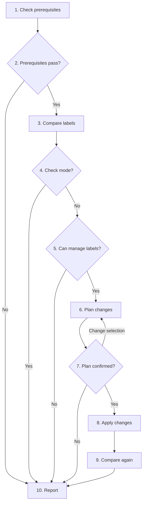

## Dependencies

- **(cli tool) gh** [Must] - GitHub official CLI. Reads the login, the repository, the permission and the labels. Creates and edits labels.
- **(cli tool) python3** [Must] - Runs `scripts/check_labels.py`.

## Args

- **groups** [Optional] - Comma-separated groups to configure: `core`, `planning`, `review`, `qa`, `delivery`, `tracking`, `community`. Default: all groups. The community group needs a yes from the user (step 6). Check mode ignores this arg and reports all groups.

Ask interactively if any **Must** arg is missing.

## Flags

- **--check** [Optional] - Check mode. Run only read commands and give the report. The labeling skills use this mode as their Step 0. If absent, give the report, then plan the changes and apply them after the user confirms.

## Flow Graph



## Flow steps

1. **Check prerequisites** - Run these read commands in the current directory and record each result:
   - `gh --version`. Exit code 0 means gh is installed.
   - `gh auth status`. Exit code 0 means the user is logged in. Get the login with `gh api user --jq .login`.
   - `gh repo view --json nameWithOwner,viewerPermission`. Exit code 0 means the directory resolves to a GitHub repository.
   - Read `viewerPermission`. `ADMIN`, `MAINTAIN`, `WRITE` and `TRIAGE` can apply labels. Only `ADMIN`, `MAINTAIN` and `WRITE` can manage labels (create and edit).
2. **Prerequisites pass?** - If gh is installed, the user is logged in and the repository resolves, go to step 3. If not, go to step 10. Skip the commands that need a failed prerequisite.
3. **Compare labels** - Run `gh label list --limit 1000 --json name,color,description | python3 <skill-dir>/scripts/check_labels.py`. `<skill-dir>` is the directory of this SKILL.md. The script reads the catalog in `references/labels.md` and prints JSON with these keys:
   - `groups` - For each group: `status` (`installed`, `partial` or `missing`), `missing` labels, `drifted` labels with the fields that differ, and `requires_not_installed`.
   - `areas` - Existing `area:` labels, with `color_ok`.
   - `stray` - Repository labels that are not in the catalog.
   - `actions` - The `gh` commands that create the missing labels and fix the drift.
4. **Check mode?** - If `--check` is passed, go to step 10. If not, go to step 5.
5. **Can manage labels?** - If the permission can manage labels (step 1), go to step 6. If not, go to step 10 and tell the user that label changes need write access.
6. **Plan changes** - Make the plan:
   1. Start with the groups in `groups`.
   2. If `groups` is not given and the community group is not installed, ask the user if the repository is open source with outside contributors. If the answer is no, do not select the community group.
   3. For each selected group, add each group in `requires_not_installed` (step 3) to the selection. Tell the user which groups you added.
   4. If the tracking group is selected, show the existing `area:` labels. Ask the user for the area names to create. Do not suggest area names.
   5. Run `gh label list --limit 1000 --json name,color,description | python3 <skill-dir>/scripts/check_labels.py --groups <selected-groups> --areas <area-names>`. Omit `--areas` when the user gave no area names.
   6. Show the plan. For each action, show the group, `create` or `edit`, the label and the command. Show the stray labels as "kept, not changed".
7. **Plan confirmed?** - If the plan has no actions, go to step 10. Ask the user to confirm the plan. If the user confirms, go to step 8. If the user changes the groups or the area names, go to step 6. If the user declines, go to step 10.
8. **Apply changes** - Run each `command` from the confirmed plan, in plan order. If a command fails, record the error and continue with the next command.
9. **Compare again** - Run the step 3 command again. Use this new result for the report.
10. **Report** - Give the user the report from the Output section.

## Rules

1. Never delete a label. Do not run `gh label delete`, and do not use `--force` with `gh label create`.
2. In check mode, run only read commands.
3. Do not create or edit a label before the user confirms the plan in step 7.
4. Use only the commands that `scripts/check_labels.py` prints. They copy the names, colours and descriptions from `references/labels.md` exactly.
5. Use the output of `scripts/check_labels.py` for the group status, the drift and the stray labels. Do not calculate them yourself.
6. Do not invent area names. Create an `area:` label only for a name that the user gives.
7. Do not install the community group unless the user names it in `groups` or says yes in step 6.
8. Do not change a stray label. Report it only.
9. Do not add labels to or remove labels from an issue or a pull request.
10. Keep the report format in the Output section. The labeling skills read it.

## Output

- In default mode, the missing labels of the selected groups are created, and their drift is fixed.
- A report to the user in this format. Check mode gives the same report without the `changes` line:

```text
configure-github report (mode: check | configure)
gh:          ok | not installed
auth:        ok as <login> | not logged in
repo:        <owner>/<name> | not a GitHub repository
permission:  <ADMIN | MAINTAIN | WRITE | TRIAGE | READ>, apply labels yes | no, manage labels yes | no
groups:
  core:      installed | partial | missing [missing - <labels>] [drift - <label> (<fields>)]
  planning:  ...
  review:    ...
  qa:        ...
  delivery:  ...
  tracking:  ...
  community: ...
areas:       <area labels, with colour drift> | none
stray:       <labels> | none
changes:     <label> created | edited | failed (<error>), one per action | none
result:      ready | not ready - <reason>
```

- `result` is `ready` when gh is installed, the user is logged in, the repository resolves, the permission can apply labels, and the core group is installed. If not, `result` is `not ready` and gives the first failed item.
- Each group line shows the group status. A group with drift is still `installed` when all its labels exist.
- Contract for `labeling-prs` and `labeling-issues`: if `result` is `not ready`, stop and tell the user to run `configure-github`. Skip each rule that uses a group that is not `installed`.
