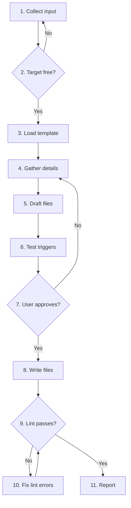

## Dependencies

- **(skill) `asd-ste100`** [Optional] - Writes the description, flow steps and rules in clear, unambiguous English.
- **(cli tool) python3** [Must] - Runs `scripts/lint_skill.py`.

## Args

- **skill-name** [Must] - Name of the new skill, in kebab-case. It is also the directory name.
- **purpose** [Must] - What the skill does and when an agent should use it.
- **category** [Optional] - Group directory under `skills/`, for example `misc`. Default: none.
- **target-dir** [Optional] - Where to create the skill. Default: `skills/<category>/<skill-name>/`, or `skills/<skill-name>/` when there is no category.

Ask interactively if any **Must** arg is missing.

## Flow Graph

## Flow steps

1. **Collect input** - Get `skill-name`, `purpose` and `category`. Ask for each **Must** arg that is missing. Set `target-dir`.
2. **Target free?** - If `<target-dir>/SKILL.md` does not exist, go to step 3. If it exists, ask the user to confirm the overwrite. If the user confirms, go to step 3. If not, ask for a different `skill-name` and go to step 1.
3. **Load template** - Read `references/templates/SKILL_TEMPLATE.md` and `references/guidelines.md`. Use the Template section for structure, the Example section for style, and the guidelines for the rules of each section.
4. **Gather details** - From `purpose`, identify the dependencies, args, flags, flow steps, rules, output, and the content that belongs in reference files. Ask the user about each item you cannot identify with confidence.
5. **Draft files** - Fill the template. Remove each optional section and optional frontmatter field that does not apply. Write the description as the guidelines specify. Number every node in the flow graph and give each node a flow step with the same number and name. Draft each reference file that the new SKILL.md loads.
6. **Test triggers** - Write 3 prompts that must start the new skill and 2 similar prompts that must not start it. Compare each prompt with the description. If a prompt gives the wrong result, change the description.
7. **User approves?** - Show the draft files and the trigger prompts to the user. If the user asks for changes, go back to step 4.
8. **Write files** - Write the approved files to `<target-dir>`. Create the directories that do not exist.
9. **Lint passes?** - Run `python3 <create-skill-dir>/scripts/lint_skill.py <target-dir>`. `<create-skill-dir>` is the directory of this SKILL.md. If the exit code is 0, go to step 11. If not, go to step 10.
10. **Fix lint errors** - Fix each error that the lint script reports. If a fix changes what the skill does, show the change to the user before you write it. Go to step 9.
11. **Report** - Tell the user which files you wrote, the lint result and the trigger prompts. Offer a dry run of the new skill with one of the prompts.

## Rules

1. Keep the section order of the template.
2. Follow `references/guidelines.md` for each section and each frontmatter field.
3. Start the `description` with "Use when".
4. The `name` in the frontmatter must be the same as the directory name.
5. Number every node in the flow graph. Each node must have a flow step with the same number and name.
6. Do not invent dependencies, args or flags. Ask the user if you are not sure.
7. Do not overwrite an existing SKILL.md without explicit user confirmation.
8. Keep the new SKILL.md at 500 lines or fewer. Move content to reference files as the guidelines specify.
9. If the `asd-ste100` skill is available, always use it for the description, flow steps and rules.

## Output

- `<target-dir>/SKILL.md`.
- Reference files, scripts and assets under `<target-dir>`, when the new skill needs them.
- A report to the user: the files written, the lint result and the trigger prompts.
