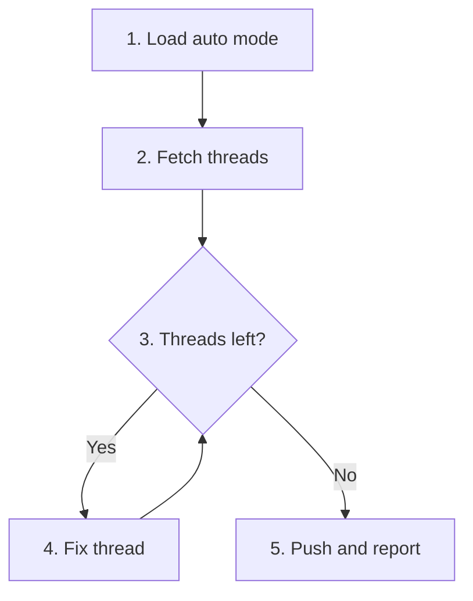

# Skill template

## Template

Copy the block below and replace each `{{...}}` placeholder.

- Optional sections: Dependencies, Args, Flags, Output. Remove each one that does not apply.
- Optional frontmatter fields: `argument-hint`, `allowed-tools`, `disable-model-invocation`. Remove each one that does not apply.
- Required: `name`, `description`, Flow Graph, Flow steps, Rules.
- Keep the section order. `references/guidelines.md` gives the rules for each section.

````markdown
---
name: {{skill-name}}
description: Use when {{situation}}. {{What the skill does}}. Triggers - {{phrase}}, {{phrase}}. Not for {{case}}.
argument-hint: "{{<arg> [--flag]}}"
allowed-tools: {{tools}}
disable-model-invocation: {{true}}
---

## Dependencies

- **({{skill|cli tool|mcp server}}) {{name}}** [{{Must|Optional}}] - {{Why the skill needs it}}

## Args

- **{{arg-name}}** [{{Must|Optional}}] - {{Meaning. Default value if Optional}}

Ask interactively if any **Must** arg is missing.

## Flags

- **--{{flag-name}}** [Optional] - {{What changes when passed. What happens when absent}}

## Flow Graph

```mermaid
flowchart TD
    A[1. {{Step name}}]
    B{2. {{Decision name}}?}
    C[3. {{Step name}}]

    A --> B
    B -->|No| A
    B -->|Yes| C
```

## Flow steps

1. **{{Step name}}** - {{What the agent does}}
2. **{{Decision name}}?** - {{How to decide. Which step each answer goes to}}
3. **{{Step name}}** - {{What the agent does}}

## Rules

1. {{Constraint that applies to all steps}}

## Output

- {{File or result the skill produces}}
- {{What the skill reports to the user at the end}}
````

## Example

A complete skill that follows the template and `references/guidelines.md`. It loads `references/auto_mode.md`, a file that this example skill would ship.

````markdown
---
name: address-pr-comments
description: Use when the user wants the open review comments on a GitHub pull request fixed. Reads each unresolved review thread, changes the code, and replies on the thread. Triggers - address PR comments, fix review feedback, resolve PR threads. Not for reviewing a pull request yourself.
argument-hint: "<pr-number> [--auto]"
---

## Dependencies

- **(cli tool) git** [Must] - Commits and pushes the changes.
- **(cli tool) gh** [Must] - GitHub official CLI. Reads the review threads and posts the replies.
- **(skill) `asd-ste100`** [Optional] - Writes the replies in clear English.

## Args

- **pr-number** [Must] - Number of the pull request.

Ask interactively if any **Must** arg is missing.

## Flags

- **--auto** [Optional] - Fix all threads without asking. If absent, ask the user before each change.

## Flow Graph



## Flow steps

1. **Load auto mode** - If `--auto` is passed, read `references/auto_mode.md`.
2. **Fetch threads** - Use `gh` to list the unresolved review threads of the pull request.
3. **Threads left?** - If an unresolved thread is left, go to step 4. If not, go to step 5.
4. **Fix thread** - Change the code for the next thread, commit, and reply on the thread with the commit hash. Go to step 3.
5. **Push and report** - Push the branch and give the user the report from the Output section.

## Rules

1. If the `asd-ste100` skill is available, always use it for the replies.
2. Do not resolve a thread that you did not fix.
3. Communicate only in English.

## Output

- One commit for each fixed thread, pushed to the pull request branch.
- A reply on each fixed thread.
- A report to the user: the fixed threads, and the skipped threads with the reason.
````
