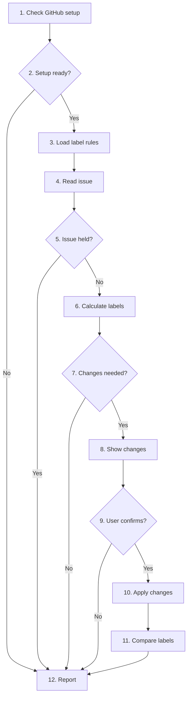

## Dependencies

- **(skill) `configure-github`** [Must] - In `--check` mode, it reports if `gh` works and which label groups the repository has.
- **(cli tool) gh** [Must] - GitHub official CLI. Reads the issue, its linked pull requests and dependencies, and applies the labels and comments.
- **(skill) `asd-ste100`** [Optional] - Writes the comments in clear English.

## Args

- **issue-number** [Must] - Number of the GitHub issue in the repository of the current directory.

Ask interactively if any **Must** arg is missing.

## Flow Graph

## Flow steps

1. **Check GitHub setup** - Run the `configure-github` skill with `--check`. Keep its report. Record the status of each group that this skill uses: `core`, `planning`, `tracking` and `community`.
2. **Setup ready?** - The setup is ready when the `result` line of the `configure-github` report is `ready`. That means `gh` is authenticated, the current directory is a GitHub repository, the user can apply labels, and the `core` group is installed. If the setup is not ready, go to step 12 and tell the user to run the `configure-github` skill. If the setup is ready, go to step 3.
3. **Load label rules** - Read `references/issue_labels.md`, `references/workflow.md` and `references/issue_transitions.md`. A group is usable only when the report of step 1 shows it as installed. Skip each rule that uses a group that is not usable.
4. **Read issue** - Read `references/gh_commands.md`. Use its read commands to get the issue and the `area:` labels of the repository. Also get the open pull requests that close the issue with their labels, and the dependencies of the issue with their state.
5. **Issue held?** - If the issue has `lock: human`, go to step 12. Do not change labels and do not post comments. If the issue has `lock: ai` or `lock: stale`, go to step 12 and report that the issue is held. If the issue has no `lock:` label, go to step 6.
6. **Calculate labels** - Apply the rules of `references/issue_transitions.md` in the given order. For each label change, record the label, the action (add or remove) and a one-line reason. Also record the comments to post, the recommendations for human-only labels, the proposals and the notes. If a rule tells you to ask the user, ask before you continue.
7. **Changes needed?** - If you recorded one or more label changes or comments, go to step 8. If not, go to step 12.
8. **Show changes** - Show the user a table with the columns Label, Action and Reason. Below the table, show the full text of each comment, the recommendations, the proposals and the notes.
9. **User confirms?** - Ask the user to confirm the changes. If the user confirms all changes, go to step 10. If the user rejects some changes, remove them from the list and go to step 10. If the user rejects all changes, go to step 12.
10. **Apply changes** - Use the write commands of `references/gh_commands.md`. Apply all label changes with one `gh issue edit` command. Then post each comment.
11. **Compare labels** - Read the labels of the issue again. Compare them with the labels that you calculated and the user confirmed. Record each difference.
12. **Report** - Give the user the report from the Output section.

## Rules

1. Change only the issue given in `issue-number`. Do not change the labels, comments or state of linked pull requests or other issues.
2. Do not add or remove these human-only labels: `spec: approved`, `dev: ready`, `qa: skipped`, `merge: auto`, `merge: blocked`, `lock: human`. Do not remove `lock: stale`. When a rule makes one of these labels the next step, recommend it in the report.
3. Do not add or remove a `lock:` label. Do not run the claim protocol (lock comment, heartbeat, release).
4. Keep one label for each namespace. If one of the labels in a namespace is human-only, ask the user which label to keep. Do not choose for the user.
5. If the issue has `X: human needed`, where X is a namespace, do not move namespace X to a different label. You can change labels in other namespaces.
6. Each time you add `X: human needed`, post a comment that says which decision a human must make.
7. Use only `area:` labels that exist in the repository. Do not create, edit or remove label definitions. The `configure-github` skill manages them.
8. Do not add `resolution:` labels, `good first issue` or `help wanted`. Propose them in the report.
9. Do not remove `status: triage`. A human removes it.
10. Do not change labels and do not post comments before the user confirms in step 9.
11. Do not close, reopen or edit the issue. Do not change its title, body or assignees.
12. Do not change labels that are not in `references/issue_labels.md` and have no namespace from it.
13. Write label names exactly as `references/issue_labels.md` gives them.
14. Follow the stage order of `references/workflow.md`. Do not add a label of a stage whose gate is closed.
15. If the `asd-ste100` skill is available, always use it for the comments.

## Output

- Label changes on the issue, after the user confirms.
- Comments on the issue: the triage proposal, the workflow comment when a label was out of order, and one comment for each `human needed` label that you add.
- A report to the user:
  - The setup status from step 1, and the groups that were used and skipped.
  - The lock status of the issue.
  - Each label added or removed, with its reason.
  - The comments posted.
  - The recommendations for human-only labels.
  - The gates that are closed, and the labels removed or flagged because they were out of order.
  - The proposals for `resolution:` and community labels.
  - The notes, for example that `size: xl` must be split.
  - Each difference found in step 11.
