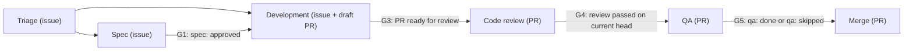

# SDLC workflow and stage gates

The `labeling-issues` and `labeling-prs` skills both use this file, and the two copies are the same. Each skill enforces the gates of its own target. It reads the other target only to get information.

## Stage order



A stage can start only when the gate in front of it is open. A new push to the PR closes G4 again: code review goes back to `code-review: needed`, and QA starts again only after the review passes on the new head.

## Terms

- **Spec gate open** - The issue has no `spec:` label, or it has `spec: approved`. A `type: spec` issue never opens the spec gate for itself. Its output is one or more `type: feature` issues.
- **Development done** - The PR is not a draft (`isDraft` is false). A draft PR means development is still in progress.
- **Human review required** - The base branch requires one or more approving reviews. Read it with `gh api repos/{owner}/{repo}/rules/branches/<base>` (a `pull_request` rule with `parameters.required_approving_review_count` of 1 or more), and with `gh api repos/{owner}/{repo}/branches/<base>/protection/required_pull_request_reviews` (`required_approving_review_count` of 1 or more). If either source says yes, human review is required. If neither source can be read, human review is required.
- **Review passed** - The PR has `code-review: done` for the current head. When human review is not required, `code-review: ai done` for the current head also counts.

## Gates

| Gate | Target | The gate is open when | Labels not permitted while the gate is closed |
|---|---|---|---|
| G1 Spec to development | issue | The spec gate is open and the type is not `type: spec` | `dev: ready`, `dev: in progress`, `dev: done` |
| G2 Development pick-up | issue | The issue has no `status: blocked`, no `resolution:` label and no `size: xl` (tracking group only) | None. Report only: an agent may not pick up the issue |
| G3 Development to code review | PR | Development is done, and each linked issue has its spec gate open | Every `code-review:` label except `code-review: human needed` |
| G4 Code review to QA | PR | The review passed | `qa: needed`, `qa: in progress`, `qa: done`, `qa: failed` |
| G5 QA to merge | PR | `qa: done` or `qa: skipped` (qa group only) | None. Report it in the merge-gate status |

Labels that a gate never removes:

- `X: human needed`. The namespace is frozen. A human can flag manual work before the stage starts.
- Human-only labels, for example `dev: ready` and `qa: skipped`.

## When a gate is closed

1. Do not add a label of the stage behind the gate.
2. If the item has a label that the closed gate does not permit, and agents may change it, remove it. The reason is `<gate>: <why the gate is closed>`.
3. If that label is human-only, do not remove it. Flag it in the report and in the workflow comment. A human removes it or opens the gate.
4. If a rule removed or flagged one or more labels because they were out of order, post the workflow comment. Do not post it when a label was removed only because a new push reset the stage.

## When a gate opens

| Gate | Entry label | Who adds it |
|---|---|---|
| G1 | `dev: ready` | A human. The skill recommends it in the report |
| G3 | `code-review: needed` | `labeling-prs` |
| G4 | `qa: needed` | `labeling-prs`, when the qa group is installed |

## Workflow comment

Replace each `<...>` part. Remove each line that does not apply.

```markdown
**Workflow order** (<skill name>)

- Removed `<label>` - <gate>: <why the gate is closed>
- Human action needed on `<label>` - <gate>: <why the gate is closed>. Remove the label, or open the gate first.

Stage order: spec approved, development, code review, QA, merge.
```
