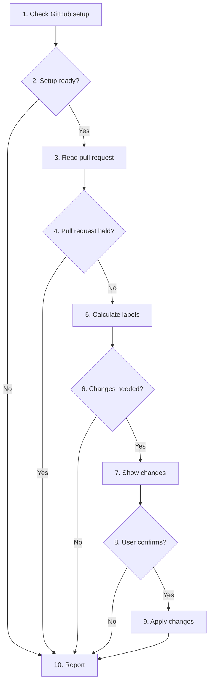

## Dependencies

- **(skill) `configure-github`** [Must] - Reports with `--check` if `gh`, the repository and the label groups are ready.
- **(cli tool) gh** [Must] - GitHub official CLI. Reads the pull request and its linked issues, and changes the labels and comments.
- **(skill) `asd-ste100`** [Optional] - Writes the comments and the report in clear English.

## Args

- **pr-number** [Must] - Number of the pull request in the current repository.

Ask interactively if any **Must** arg is missing.

## Flow Graph

## Flow steps

1. **Check GitHub setup** - Run the `configure-github` skill with `--check`. Record the status of `gh`, authentication, repository and permission. Record the status of each label group: installed, partial or missing.
2. **Setup ready?** - The setup is ready when `gh` is authenticated, the current directory is a GitHub repository, the user can change labels, and the `core` group is installed. If the setup is ready, go to step 3. If not, tell the user to run the `configure-github` skill and go to step 10.
3. **Read pull request** - Run these commands and keep the results:
   - `gh pr view <pr-number> --json number,title,body,state,isDraft,author,labels,headRefOid,baseRefName,closingIssuesReferences,comments,mergeStateStatus,url`
   - `gh api repos/{owner}/{repo}/pulls/<pr-number>/reviews --paginate`. Use `user.type`, `state` and `commit_id` of each review.
   - `gh issue view <issue-number> --json number,state,labels` for each issue in `closingIssuesReferences`.
   - `gh label list --limit 1000 --json name`. Keep the names that start with `area: `.
   - The two "Human review required" commands of `references/workflow.md`, for the base branch `baseRefName`.
   - `gh pr checks <pr-number> --json name,bucket`, only when the `delivery` group is installed.
4. **Pull request held?** - The pull request is held when it has `lock: human`, `lock: ai` or `lock: stale`, or when its state is `CLOSED` or `MERGED`. If it is held, make no change, post no comment, and go to step 10. If not, go to step 5.
5. **Calculate labels** - Read `references/pr_label_catalog.md`, `references/workflow.md` and `references/pr_transition_rules.md`. Apply the transition rules in their order to the data from step 3. For each label to add or remove, write one line with the reason. Write the text of each comment to post. Write the recommendations for human-only labels and the merge-gate status.
6. **Changes needed?** - If the calculation has a label change or a comment to post, go to step 7. If not, go to step 10.
7. **Show changes** - Show the user a table with the columns Action (add or remove), Label and Reason. Show the text of each comment. Show each question for a namespace conflict that the rules give to the user.
8. **User confirms?** - Ask the user to confirm the changes. If the user confirms all or some of the changes, keep only the confirmed changes and go to step 9. If the user confirms no change, go to step 10.
9. **Apply changes** - Run one command for all label changes: `gh pr edit <pr-number> --add-label "<label>" --remove-label "<label>"`. Post each comment with `gh pr comment <pr-number> --body-file <file>`. Read the labels again with `gh pr view <pr-number> --json labels` and compare them with the confirmed result.
10. **Report** - Give the user the report from the Output section.

## Rules

1. Change only the labels and comments of the pull request `<pr-number>`. Do not change the linked issue or other items.
2. Never add or remove a human-only label: `spec: approved`, `dev: ready`, `qa: skipped`, `merge: auto`, `merge: blocked`, `lock: human`. If a rule says that a human-only label comes next, recommend it in the report.
3. Never add or remove a `lock:` label. Do not claim, refresh or release a lock.
4. Never add or remove a `merge:` label. Report the merge-gate status as information only.
5. When the pull request has `X: human needed`, do not change namespace `X`. You can change the other namespaces.
6. Each time you add `X: human needed`, post a comment that says which decision a human must make.
7. Keep one value in each namespace. If a namespace conflict includes a human-only label, do not choose. Ask the user.
8. Skip each rule that uses a label group that is partial or missing.
9. Use only `area:` labels that exist in the repository. Do not create labels. The `configure-github` skill creates labels.
10. Use the label names exactly as `references/pr_label_catalog.md` writes them.
11. Do not change GitHub before the user confirms the changes.
12. Follow the stage order of `references/workflow.md`. Do not add a label of a stage whose gate is closed.
13. If the `asd-ste100` skill is available, always use it for the comments and the report.

## Output

- Label changes and comments on the pull request, as the user confirmed them.
- A report to the user:
  - The setup status from step 1, and the reason when the skill stopped.
  - The labels added and removed, each with its reason.
  - The comments posted.
  - The recommendations for human-only labels.
  - The gates that are closed, and the labels removed or flagged because they were out of order.
  - The labels that are not in the catalog. The skill does not change them.
  - The merge-gate status, as information only.
