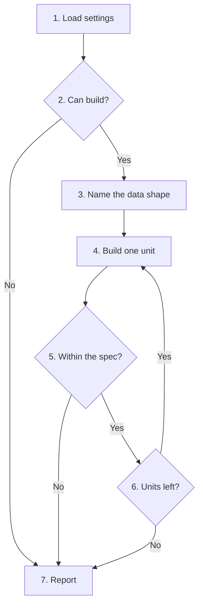

## Dependencies

- **(skill) `root-cause`** [Must] - Applied when a test, a check or the build breaks.

## Args

- **task** [Must] - Number or key of a `shaped` task, or, for XS work, the edit in words.

Ask interactively if any **Must** arg is missing.

## Flags

- **--auto** [Optional] - Follow the spec without check-ins. If absent, show the data shape before the logic and ask at each choice the spec leaves open.

## Flow Graph

## Flow steps

1. **Load settings** - If `.sdlc/settings.json` or `.sdlc/scripts/` does not exist, stop and print `Next: /setup` as the last line. Read `default_branch`, `issue.*`, `task.path`, `spec.storage`, `sizing.*` and the `guides.development` file. If the guide is `null`, say that you run without one. Read the reference for `issue.tracker`: `references/tracker_github.md`, `references/tracker_jira.md` or `references/tracker_linear.md`. If `--auto` is passed, read `references/auto_mode.md`.
2. **Can build?** - A task needs the `shaped` or `in-progress` stage, its branch checked out, and its spec in `<task.path>/<task>/SPEC.md` or on the issue. An XS edit needs no ticket and no folder. It must meet the XS conditions: at most `sizing.xs_max_files` files, about `sizing.xs_max_lines` lines, nothing under `sizing.risk_paths` and no behaviour change. For XS, the edit is the spec. If a condition fails, go to step 7 and name it. If not, set the stage of the task to `in-progress` as the tracker reference says (for XS, create a branch from `origin/<default_branch>` instead) and go to step 3.
3. **Name the data shape** - Before any logic, write the types, records or messages that the change adds or changes, as the spec says.
4. **Build one unit** - Take the next item of the spec's test plan. Where a seam exists, write the test first and see it fail. A bug fix starts with a failing test that shows the bug. When something breaks, apply `root-cause`. End the unit with a passing check and commit it.
5. **Within the spec?** - Run `git diff --shortstat origin/<default_branch>...HEAD -- . ':!<task.path>'`. If the inserted plus deleted lines pass `sizing.review_limit`, or the next unit needs a decision that the spec does not cover, stop for a re-size: write the signal in a comment on the issue and go to step 7. If not, go to step 6.
6. **Units left?** - If the test plan has an item that is not built, go to step 4. If not, go to step 7.
7. **Report** - Give the report from the Output section. Then run `sh .sdlc/scripts/next_step.sh <ref> --after build`, with `--auto` when it was passed, and print its output as the last lines. `<ref>` is the task, or `-` for XS. Add `--result fail` after a stop in step 2 or 5. Add `--keep "<open items>"` with what the run leaves open, such as failing checks or the reason for a stop.

## Rules

1. Never make a decision that the spec does not cover. Stop and name it.
2. Never commit a unit whose check fails.

## Output

- Commits on the task branch, the task `in-progress`, and a report: the commits, the checks run, the diff size against `sizing.review_limit`, any stop with its reason, and the `Next:` line last.
