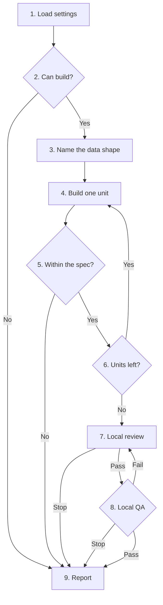

## Dependencies

- **(skill) `root-cause`** [Must] - Applied when a test, a check, the build, or local QA fails.
- **(skill) `review`** [Must] - Runs the local self-review of the branch and its verify.
- **(skill) `prove`** [Must] - Runs local self-QA on the running surface.
- **(skill) `orchestrator`** [Must] - Says how to start `review` in a fresh subagent.

## Args

- **task** [Must] - Number or key of a `shaped` task, or, for XS work, the edit in words.

Ask interactively if any **Must** arg is missing.

## Flags

- **--auto** [Optional] - Follow the spec without check-ins and take the recommendation for each local review finding. If absent, show the data shape before the logic, ask at each choice the spec leaves open, and ask which findings to fix.

## Flow Graph

## Flow steps

1. **Load settings** - If `.sdlc/settings.json` or `.sdlc/scripts/` does not exist, stop and print `Next: /setup` as the last line. Read `default_branch`, `issue.*`, `specs.path` (fallback `.sdlc/specs`), `specs.archive_path` (fallback `.sdlc/specs/archived`), `work.path` (fallback `.sdlc/work`), `task.path` (fallback `.sdlc/task`), `spec.storage`, `sizing.*`, and the `guides.development` file. If the guide is `null`, say that you run without one. Read the reference for `issue.tracker`: `references/tracker_github.md`, `references/tracker_jira.md`, or `references/tracker_linear.md`. If `--auto` is passed, read `references/auto_mode.md`.
2. **Can build?** - A task needs the `shaped` or `in-progress` stage and its merged spec on `origin/<default_branch>` at `<specs.path>/<task>-*.md` (excluding `*-design.md` and `<specs.archive_path>/`), falling back to `<task.path>/<task>/SPEC.md` or the issue comment `## SPEC.md` when `spec.storage` is `issue_comment`. Fetch `origin <default_branch>` and switch to or create `<task>-<slug>` from `origin/<default_branch>` (keep an existing `in-progress` branch for `<task>`). An XS edit needs no ticket and no spec file; it must meet the XS conditions (at most `sizing.xs_max_files` files, about `sizing.xs_max_lines` lines, nothing under `sizing.risk_paths`, and no behaviour change) on a branch from `origin/<default_branch>`. If a condition fails, go to step 9 and name it. Otherwise create `<work.path>/<task>/` (or `<work.path>/xs/` for XS) without staging or committing it (if `git check-ignore -q <work.path>` fails, warn to gitignore `<work.path>/` via `setup`), set the task stage to `in-progress` as the tracker reference says (skip for XS), and go to step 3.
3. **Name the data shape** - Before any logic, write the types, records or messages that the change adds or changes, as the spec says.
4. **Build one unit** - Take the next item of the spec's test plan. Where a seam exists, write the test first and see it fail. A bug fix starts with a failing test that shows the bug. When something breaks, apply `root-cause`. End the unit with a passing check and commit it.
5. **Within the spec?** - Run `git diff --shortstat origin/<default_branch>...HEAD -- . ":!<work.path>"` (also excluding `":!<task.path>"` when set). If inserted plus deleted lines pass `sizing.review_limit`, or the next unit needs a decision that the spec does not cover, stop for a re-size: write the signal in a comment on the issue and go to step 9. If not, go to step 6.
6. **Units left?** - If the test plan has an item that is not built, go to step 4. If not, go to step 7.
7. **Local review** - Read `references/local_review.md` and run it: review the branch in a fresh subagent, write `<work-folder>/self-review.md` (never commit it), apply chosen fixes, and verify them. On a stop or re-size, go to step 9; when it passes, go to step 8.
8. **Local QA** - Run `prove <ref> --local` (with `--auto` when passed), writing `<work-folder>/self-qa.md` without committing it. If it passes, go to step 9. If checks fail on the running surface, apply `root-cause`, commit the fix, run the step 5 diff check (stop for re-size if exceeded), and loop back to step 7 so self-review and self-QA both pass on `HEAD`. If `prove --local` stops because the app cannot run or setup is missing, go to step 9.
9. **Report** - Give the report from the Output section. `<ref>` is the task, or `-` for XS. Pass `--auto` to `next_step.sh` when this run has it, and print its output as the last line: when both steps 7 and 8 pass, run `sh .sdlc/scripts/next_step.sh <ref> --after prove --result pass`; after a stop in step 2 or 5 or a re-size in step 7 or 8, run `sh .sdlc/scripts/next_step.sh <ref> --after build --result fail`; after a review stop in step 7, run `sh .sdlc/scripts/next_step.sh <ref> --after review --result fail`; after a setup or run stop in step 8, run `sh .sdlc/scripts/next_step.sh <ref> --after prove --result fail`.

## Rules

1. Never make a decision that the spec does not cover. Stop and name it.
2. Never commit a unit whose check fails.
3. Never stage or commit files under `<work.path>/`.

## Output

- Commits on the task branch, `<work.path>/<id>/self-review.md` and `<work.path>/<id>/self-qa.md` (uncommitted), the task `in-progress`, and a report: the commits, the checks run, the diff size against `sizing.review_limit`, each local review finding with its decision and result, the local QA result, any stop with its reason, and the `Next:` line last.
