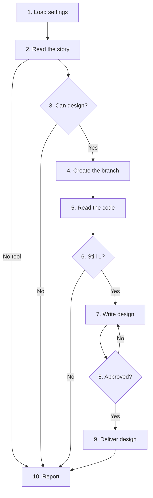

## Args

- **story** [Must] - Number or key of a `ready` L story that has no tasks yet.

Ask interactively if any **Must** arg is missing.

## Flags

- **--auto** [Optional] - Write, verify, apply blocking findings, and deliver the design without asking. If absent, stop for approval when `spec.review` is `manual`.

## Flow Graph

## Flow steps

1. **Load settings** - If `.sdlc/settings.json` or `.sdlc/scripts/` does not exist, stop and print `Next: /setup` as the last line. Read `default_branch`, `issue.*`, `specs.*`, `work.path`, `spec.*`, `sizing.*`, `templates.design`, and `guides.development`. If `guides.development` is `null`, say that you run without one. Read `references/tracker_github.md`, `references/tracker_jira.md`, or `references/tracker_linear.md` for `issue.tracker`. If `--auto` is passed, read `references/auto_mode.md`.
2. **Read the story** - Read the story with its title, body, labels, parent, sub-issues, and comments, as the tracker reference says.
3. **Can design?** - The issue must be a `ready` L story with no sub-issues yet. If it is not `ready`, not size `L`, not a story, or already has tasks, go to step 10 and name the cause. If not, go to step 4.
4. **Create the branch** - Read `references/delivery.md`. When `specs.delivery` is `pr`, or `spec.storage` is `local` or `both`, fetch `origin <default_branch>` and switch to `design/<story>-<slug>` from `origin/<default_branch>` (or create it).
5. **Read the code** - Read the code that the story touches to identify decisions shared across tasks (data model, changed contracts, module boundaries, patterns to follow). When a decision needs an outside fact that the code cannot give, run the `research` skill with that one question.
6. **Still L?** - Read `references/design.md`. If no section holds a decision shared by two or more tasks, set the story size to `M` as the tracker reference says, write the reason in a comment on the story, write no design, and go to step 10. If an open question changes the data model or a public contract and cannot be resolved, stop and go to step 10.
7. **Write design** - Write `<specs.path>/<story>-<slug>-design.md` from `templates.design` (or `assets/templates/design.md` if missing, and note that in the report), storing it as `references/delivery.md` and `spec.storage` say.
8. **Approved?** - If `spec.review` is `auto` (or `--auto` is passed when `spec.review` is not `pr`), run `verify-spec` on the design and apply each blocking finding. If `spec.review` is `manual`, show the design to the person; if changes are requested, go to step 7. If approved, `spec.review` is `off`, or `spec.review` is `pr` (reviewed on the Design PR), go to step 9.
9. **Deliver design** - Follow `references/delivery.md`: when `specs.delivery` is `pr`, commit `<specs.path>/<story>-<slug>-design.md`, push `design/<story>-<slug>`, and open a Design PR (`Design for #<story>`); leave the story `ready` until merge. When `specs.delivery` is `direct`, commit the file (if `local` or `both`), post or update the issue comment (if `issue_comment` or `both`), and set the story stage to `shaped`.
10. **Report** - Give the report from the Output section. Run `sh .sdlc/scripts/next_step.sh <story> --after design` (with `--auto` if passed, and `--result fail` after a stop in step 2, 3, or 6) if supported and print its output last; if `next_step.sh` does not yet know `design`, print `Next: /sdlc:verify-spec <pr>` for a Design PR or `Next: /sdlc:slice <story>` when `shaped` or downgraded to `M`.

## Rules

1. Never restate story requirements. Link to the story instead.
2. Only include decisions shared by two or more tasks; single-task details belong in task specs later.
3. Never use `Closes #<story>`, `Fixes #<story>`, or `Resolves #<story>` in a Design PR body; use `Design for #<story>`.

## Output

- `<specs.path>/<story>-<slug>-design.md` (and the Design PR link when `specs.delivery` is `pr`, or story `shaped` when `direct`), verification findings, any size change with its signal, and the `Next:` line last.
