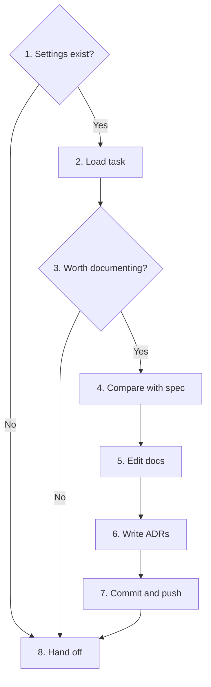

## Dependencies

- **(cli tool) git** [Must] - Reads the diff, commits and pushes the docs.
- **(cli tool) gh** [Must] - GitHub official CLI. Reads the size label and finds the PR.

## Args

- **task** [Optional] - Issue number of the task. Default: the issue that the PR of the current branch closes.

## Flags

- **--auto** [Optional] - Adds `--auto` to the Next line. The run asks nothing in either mode. If absent, the Next line has no `--auto`.

## Flow Graph

## Flow steps

1. **Settings exist?** - If `.sdlc/settings.json` exists, go to step 2. If not, stop and print `Next: /setup` as the last line.
2. **Load task** - Read `default_branch` and `task.path` from the settings. Get the PR with `gh pr view --json number,closingIssuesReferences`, then the size label with `gh issue view <task> --json labels`. Read the diff with `git diff origin/<default_branch>...HEAD`, without the task folder. Read `<task.path>/<task>/SPEC.md` and the newest run in `<task.path>/<task>/QA.md`.
3. **Worth documenting?** - If the label is `size:XS`, or the diff changes nothing a reader would look up (an internal refactor, tests only, build files), note the reason and go to step 8. If not, go to step 4.
4. **Compare with spec** - List each point where SPEC.md and the diff or QA.md disagree, for example a dropped option, a renamed setting or a changed default. The diff and QA.md win.
5. **Edit docs** - Find the docs the project already has: README files, a docs folder and the pages they link to. Write how the change works now: behaviour, configuration and extension points. Edit the page a reader opens first for this topic. Add a page only when no page covers the topic.
6. **Write ADRs** - Find each decision in SPEC.md that the diff carries out and that names the alternatives it rejected. Write one ADR for each, in the folder and format of the existing ADRs. If there are none, create `docs/adr/NNNN-<slug>.md` with Status, Context, Decision, Rejected alternatives and Consequences.
7. **Commit and push** - If steps 5 and 6 changed no file, go to step 8. Commit the docs changes in one commit. In the commit body, list the spec differences from step 4. End the message with the trailer `SDLC-Docs-Only: true`. Push to the PR branch.
8. **Hand off** - Give the report from the Output section. Run `sh .sdlc/scripts/next_step.sh <pr> --after document`, with `--auto` if the flag is passed. Print its output as the last lines.

## Rules

1. Never ask the user a question. Both modes run the same flow.
2. Every statement you add to the docs must come from the diff or QA.md. Use SPEC.md only for the reason behind a change that the diff confirms.
3. Do not put plans, task ids or restated requirements in the docs. Rejected alternatives go only into an ADR.
4. Change only documentation files. Do not change code, tests, config, labels or the task folder. The `SDLC-Docs-Only` trailer promises that behaviour did not change.

## Output

- Docs changes and ADRs, in one commit on the PR branch.
- A report: the pages changed, the ADRs added, each difference between the spec and the build, or the reason for the skip.
- The `Next:` line as the last line.
