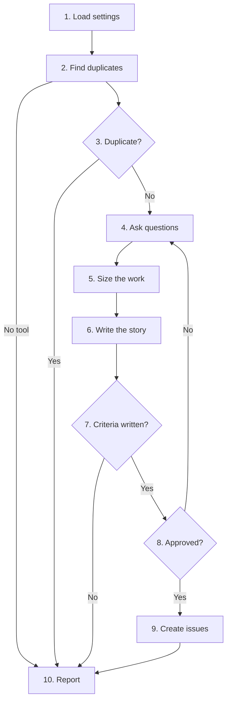

## Args

- **request** [Must] - The raw request as text or a file path, or the number of an issue to frame again (a story of an epic, or a request filed as is).

Ask interactively if any **Must** arg is missing.

## Flags

- **--auto** [Optional] - Ask nothing. Take the size from the signals and the narrower scope. If absent, ask and stop for size and story approval.

## Flow Graph

## Flow steps

1. **Load settings** - If `.sdlc/settings.json` or `.sdlc/scripts/` does not exist, stop and print `Next: /setup` as the last line. Read `issue.tracker`, `sizing.*`, `issue.estimation`, `templates.*` and the `guides.labeling` file. If the guide is `null`, say that you run without one. If `--auto` is passed, read `references/auto_mode.md`.
2. **Find duplicates** - Read the reference for `issue.tracker`: `references/search_github.md`, `references/search_jira.md` or `references/search_linear.md`. Search open and closed issues for the key terms of the request as it says. Skip the issue that you frame again.
3. **Duplicate?** - An open issue with the same outcome is a duplicate. If there is one, go to step 10 and name it. If not, go to step 4.
4. **Ask questions** - Suggest a depth from the request: light (1 to 5 questions), medium (6 to 10) or deep (more than 10). Ask the person to confirm or change it. Then ask questions up to that depth, only those whose answer changes the scope or an acceptance criterion. Stop early when no open question changes the scope. Read the code only to learn how the system behaves now, never to design.
5. **Size the work** - Read `references/sizing.md`. Answer its four questions in order, and print the size line.
6. **Write the story** - Read `references/story.md` and write the issue body. Skip this step for XS.
7. **Criteria written?** - For XS, go to step 8. If no acceptance criterion can be written as observable behaviour, go to step 10 and say what is missing. If not, go to step 8.
8. **Approved?** - Show the size line and the story. If the person corrects a signal or the story, go to step 4. If the person approves, go to step 9.
9. **Create issues** - Create only what the size needs. XS gets nothing, S gets one task, and M and L get one story. XL gets an epic with one sub-issue for each story (`gh issue create --parent <epic>`). Frame an existing issue in place with `gh issue edit`. Add the labels that the labeling guide asks for. On each sized issue, run `sh .sdlc/scripts/size.sh <issue> <size>` and `sh .sdlc/scripts/stage.sh <issue> ready`. The stories of an epic get no labels until their own `frame` run.
10. **Report** - Give the report from the Output section. Then run `sh .sdlc/scripts/next_step.sh <ref> --after frame`, with `--auto` when it was passed, and print its output as the last line. `<ref>` is the new issue, `-` for XS, the duplicate after step 3, or `- --result fail` after a stop in step 2 or 7.

## Rules

1. Never put implementation detail in a story: no class names, files, schema or how to build it.

## Output

- The issues, with size and stage labels, and a report: the size line, the issue links, the duplicates found, and the `Next:` line last.
