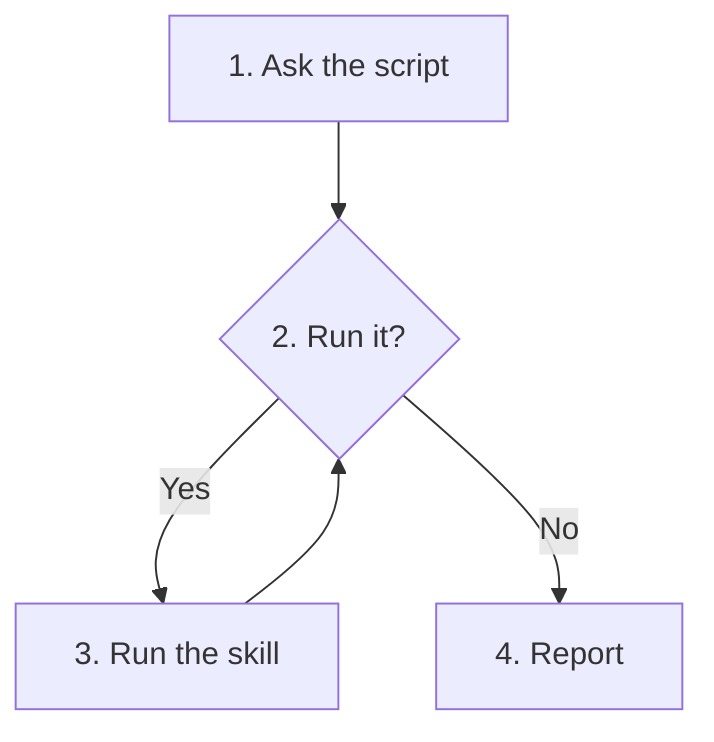

## Dependencies

- **(skill) `orchestrator`** [Must] - Says how to run each skill in a fresh subagent.

## Args

- **ref** [Optional] - Issue or PR number. Default: `-`, the next ready task.

## Flags

- **--run** [Optional] - Run skills until one stops for a person. If absent, run one skill.
- **--auto** [Optional] - Pass `--auto` to every skill and run until a hard stop or a wait. If absent, the skills ask at their gates.

## Flow Graph

## Flow steps

1. **Ask the script** - Run `sh .sdlc/scripts/next_step.sh <ref>`, with `--auto` when the user passed it. Keep its `Next:` line.
2. **Run it?** - A line can run when it holds a skill command with no `<...>` placeholder. The first skill always runs. Later skills run only with `--run` or `--auto`. If the line runs, go to step 3. If not, go to step 4.
3. **Run the skill** - Read `references/harness.md`. Follow `orchestrator` to run the command in a fresh subagent. Ask it for a summary and the last `Context:` and `Next:` lines. If the skill asks a person something, ask the person, then start a new subagent with the brief, the question and the answer. With `--run`, a question also ends the loop after that skill. Keep the new `Next:` line and go to step 2.
4. **Report** - List each skill that ran with its summary. Print the last `Context:` line, if there is one, and the last `Next:` line as the last lines.

## Rules

1. Stop when the same command comes up a third time in one run, and say so.
