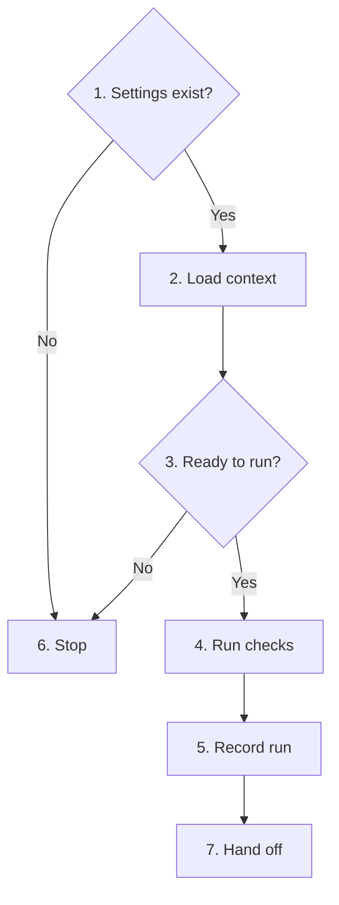

## Dependencies

- **(skill) `orchestrator`** [Must] - Says how to start and brief the fresh-context Official QA subagent on a PR.
- **(cli tool) git** [Must] - Names the commit under test, fetches the PR head, and checks for uncommitted code changes.
- **(cli tool) gh** [Must] - Reads the PR and acceptance criteria on the issue, and posts the Official QA comment.

## Args

- **target** [Optional] - Pull request number (Official PR QA), or task issue number / `-` (with `--local` for self-QA or XS work). Default: none, for `--local` XS work or current-branch PR with `--auto`.

## Flags

- **--local** [Optional] - Runs author-side self-QA and writes `<work.path>/<id>/self-qa.md` without committing (default when `target` is `-`, omitted without a branch PR, or a non-PR task issue).
- **--auto** [Optional] - Never ask. With no `target` and no `--local`, proves the PR of the current branch (or `--local -` if none). Adds `--auto` to the `Next:` line.

## Flow Graph



## Flow steps

1. **Settings exist?** - If `.sdlc/settings.json` exists, go to step 2. If not, go to step 6.
2. **Load context** - Read `work.path` (fallback `.sdlc/work`), `specs.path` (fallback `.sdlc/specs`), `specs.archive_path` (fallback `.sdlc/specs/archived`), `task.path` (fallback `.sdlc/task`), `spec.storage`, `review.prefix` (fallback `:robot:`), and `guides.qa` from `.sdlc/settings.json`. Select mode: when `--local` is absent and `target` (or the current branch PR when `--auto` has no `target`) resolves via `gh pr view <target> --json number,headRefOid,closingIssuesReferences,files` to a PR, run **Official PR QA**; otherwise run **Local self-QA**. In Official PR QA, if `files` is non-empty and every path is under `<specs.path>/` (Spec/Design-only PR), go to step 6; otherwise resolve `<task>` from `closingIssuesReferences` (none for XS PRs). In Local self-QA, create `<work.path>/<task>/` (or `<work.path>/xs/` for `-` or omitted) with `mkdir -p`, never stage or commit it, and warn if `git check-ignore -q <work.path>` fails. In both modes, read the acceptance criteria with `gh issue view <task>` (when `<task>` exists) and the test plan from `<specs.path>/<task>-*.md` (excluding `*-design.md` and `<specs.archive_path>/`, fallback `<task.path>/<task>/SPEC.md` or issue comment `## SPEC.md` when `spec.storage` is `issue_comment`). If `guides.qa` is `null`, say that the run has no QA guide.
3. **Ready to run?** - In Local self-QA, run `git status --porcelain -- . ":!<work.path>"`; if any file outside `<work.path>/` has changes, go to step 6, and verify the app, endpoint, or command runs as `guides.qa` says (go to step 6 if it fails). In Official PR QA, run `git fetch origin pull/<pr>/head`; use the current checkout only if `HEAD` equals `headRefOid` and `git status --porcelain -- . ":!<work.path>"` is empty, otherwise attach a clean detached worktree at `headRefOid` outside the repo (remove it after step 4). If the PR head cannot be checked out cleanly, go to step 6.
4. **Run checks** - In Local self-QA, check each acceptance criterion on the real surface and record the exact command or action and what you saw. In Official PR QA, save the issue body and spec/test-plan inputs in a temporary folder outside the repo, read `references/official_qa_brief.md`, and follow `orchestrator` to start one fresh-context subagent against the clean PR head checkout (`headRefOid`). Read the subagent's JSON output, verify `commit` equals current `headRefOid` (re-check `gh pr view <pr> --json headRefOid`) and that every cited command/action and observation is recorded.
5. **Record run** - In Local self-QA, prepend the run below at the top of `<work-folder>/self-qa.md` without committing it, and on a pass run `sh .sdlc/scripts/qa_check.sh <work-folder>` (fixing `self-qa.md` until it exits 0). In Official PR QA, write the Official QA report below to a temporary file outside the repo and post one PR comment with `gh pr comment <pr> --body-file <tmp-file>` (check `headRefOid` still matches). Go to step 7.
6. **Stop** - Write nothing to `self-qa.md` and post no PR comment. Say why the run stopped: missing settings, Spec/Design-only PR (no app QA needed), uncommitted changes, PR head mismatch, or what you tried and the error. Print `Next: /setup` when settings are missing; otherwise print `Next: /prove <target> [--local]` (with `--auto` when passed).
7. **Hand off** - Run `sh .sdlc/scripts/next_step.sh <ref> --after prove --result <pass|fail>`, with `--auto` when passed (`<ref>` is `<pr>` in Official PR QA, `<task>` or `-` in Local self-QA). Print its output as the last line.

Local `self-qa.md` entry:
```
## Run <ISO date>
Commit: <full sha of HEAD>
Result: pass|fail
### Steps
- <command or action> -> <what you saw>
```

Official QA PR comment:
```
<review.prefix> [qa] <pass|fail>
Commit: <full 40-char headRefOid>
Date: <ISO date>

### Checks
- <command or action> -> <what you saw>
```

## Rules

1. A check passes only on the real surface. A clean build and green tests are not a pass for behaviour that a user, API client or operator sees.
2. The run is a pass only when every check passed. A check that you skipped or could not run makes the run a fail.
3. Write what you saw, not what you expected. On a fail, write enough for `build` to reproduce it.
4. Do not change code. `build` fixes what `prove` finds.
5. Never edit an older `self-qa.md` run or delete an older Official QA PR comment. Describe screens in words.
6. Write each assumption, such as how you started the app without a QA guide, under `## Assumptions` directly below the run or `### Checks`.
