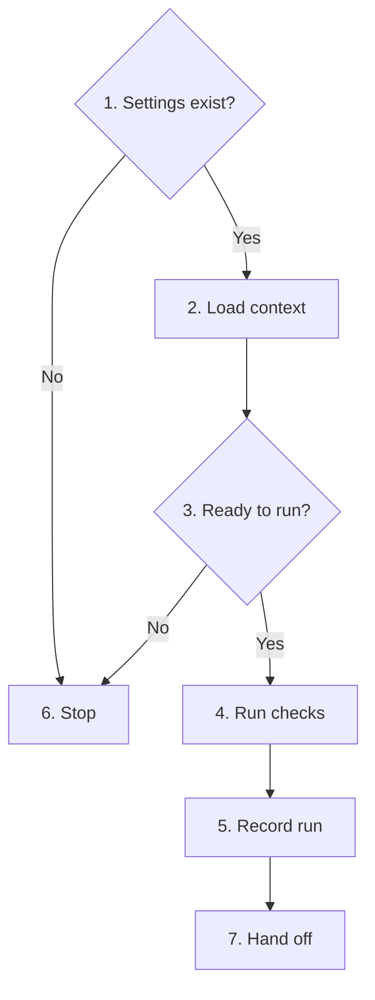

## Dependencies

- **(cli tool) git** [Must] - Names the commit under test and commits `QA.md`.
- **(cli tool) gh** [Must] - Reads the acceptance criteria on the issue.

## Args

- **task** [Optional] - Issue number of the task. Default: none, for XS work, which has no issue and no task folder.

## Flags

- **--auto** [Optional] - Adds `--auto` to the `Next:` line. The run asks nothing in either mode.

## Flow Graph



## Flow steps

1. **Settings exist?** - If `.sdlc/settings.json` exists, go to step 2. If not, go to step 6.
2. **Load context** - Read the settings. The task folder is `<task.path>/<task>/`. For XS work it is `$(git rev-parse --git-path sdlc/qa)`, which git does not track. Read the acceptance criteria with `gh issue view <task>` and the test plan in `SPEC.md`. Read the guide in `guides.qa`. If it is null, say that the run has no QA guide.
3. **Ready to run?** - Run `git status --porcelain`. If a file outside the task folder has changes, go to step 6, because the evidence must name a commit. Start the app, or reach the endpoint or command, as the QA guide says. If it does not run, go to step 6. If it runs, go to step 4.
4. **Run checks** - For each acceptance criterion, check the behaviour where a user, API client or operator meets it. Write down the exact command or action and what you saw.
5. **Record run** - Add the run at the top of `QA.md` in the format below, then commit `QA.md` alone. XS work does not commit it. On a pass, run `sh .sdlc/scripts/qa_check.sh <task-folder>` and fix `QA.md` until it exits 0. Go to step 7.
6. **Stop** - Write nothing to `QA.md`. Say why the run stopped: no settings, the changed files, or what you tried and the error. Print `Next: /setup` when the settings are missing. If not, print `Next: /prove <task>` to run after the fix, with `--auto` when this run has it.
7. **Hand off** - Run `sh .sdlc/scripts/next_step.sh <task or -> --after prove --result <pass|fail>`, with `--auto` when this run has it. Print its output as the last line.

```
## Run <ISO date>
Commit: <full sha of HEAD before you commit QA.md>
Result: pass|fail
### Steps
- <command or action> -> <what you saw>
```

## Rules

1. A check passes only on the real surface. A clean build and green tests are not a pass for behaviour that a user, API client or operator sees.
2. The run is a pass only when every check passed. A check that you skipped or could not run makes the run a fail.
3. Write what you saw, not what you expected. On a fail, write enough for `build` to reproduce it.
4. Do not change code. `build` fixes what `prove` finds.
5. Never edit an older run. `QA.md` is text only, so describe a screen in words.
6. Write each assumption, such as how you started the app without a QA guide, under an `## Assumptions` heading directly below the run.
