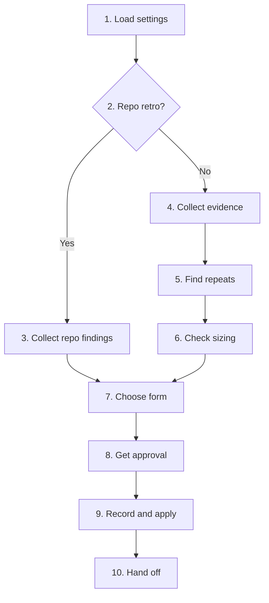

## Dependencies

- **(cli tool) jq** [Must] - `scripts/transcript_extract.sh` reads the JSONL transcripts with it.
- **(cli tool) gh** [Must] - Reads the size label of the task and its merged pull request.
- **(cli tool) zstd** [Optional] - `scripts/transcript_extract.sh` reads compressed Codex transcripts with it.

## Args

- **task** [Optional] - Issue number of the shipped task. Required when `--repo` is absent.

Ask interactively if any **Must** arg is missing.

## Flags

- **--repo** [Optional] - Run a repo retro over all task folders. If absent, run a feature retro on one task.
- **--auto** [Optional] - Do not ask. Mark every proposal `proposed`, apply nothing, and write each choice you made instead of asking under `## Assumptions` in `RETRO.md`. If absent, the user accepts or rejects each proposal.

## Flow Graph

## Flow steps

1. **Load settings** - If `.sdlc/settings.json` does not exist, stop and print `Next: /setup` as the last line, with `Context: clear - setup needs nothing from this session. Run /clear before the next command.` just above it in Claude Code. Read `task.path`, `retro.scope`, `templates.retro` and the `sizing` keys.
2. **Repo retro?** - If `--repo` is passed, go to step 3. If not, go to step 4.
3. **Collect repo findings** - Read `references/repo_retro.md` and do what it says. Go to step 7.
4. **Collect evidence** - Read `references/harness.md`. For each harness in it, run `sh .sdlc/scripts/transcript_extract.sh --harness <name> --worktree <path>`. `<path>` is the worktree of the task when `retro.scope` is `worktree`, and the repo root when it is `repo`. If the worktree is gone, ask the user for its path, or use the repo root with `--auto`. If every run exits non-zero, there is no chat data: tell the user and use only the review data. Read `<task.path>/<task>/REVIEW.md`. If the folder was removed, read the file from git history.
5. **Find repeats** - Group the user messages and review threads by the mistake that they correct. Keep a group only when it holds two or more corrections. Drop each lesson that a `RETRO.md` under `<task.path>` marks as rejected.
6. **Check sizing** - Compare the size label of the task with the merged pull request: changed files, changed lines, tasks and modules. If the size was wrong, propose a change to one `sizing` key, never more.
7. **Choose form** - For each lesson, take the cheapest form that stops the repeat: a lint rule or a test, then a line in a guide, then an edit to a skill, then a note. Name the file that the lesson changes.
8. **Get approval** - Show the proposals. Ask the user to accept or reject each one, and ask for the reason of each rejection. Skip this step with `--auto`.
9. **Record and apply** - Write `RETRO.md` in the format of `references/retro_format.md`. Apply each accepted lesson. Do not commit.
10. **Hand off** - Run `sh .sdlc/scripts/next_step.sh <task> --after retro`, with `--auto` if it was passed. Use `-` for `<task>` in a repo retro. Print its output as the last lines.

## Rules

1. Never open a transcript file. Read chats only through the script output.
2. Write each lesson in your own words. Never copy chat or review text into a file.
3. Change no file other than `RETRO.md` before the user accepts the change.

## Output

- `RETRO.md` with each lesson and its status, and the accepted changes, not committed.
- A report to the user: each lesson with its form and status, and whether chat data was used.
