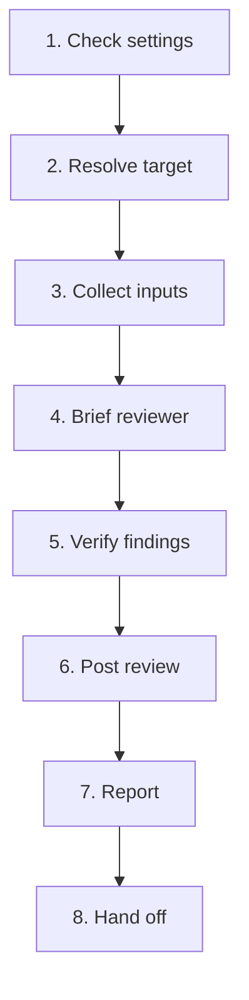

## Dependencies

- **(skill) `orchestrator`** [Must] - Says how to start and brief the reviewer.
- **(cli tool) gh** [Must] - Reads the PR and the issue, and posts the review.
- **(cli tool) git** [Must] - Fetches the PR head commit.

## Args

- **target** [Must] - A PR number, an issue number, or the path of a `SPEC.md` or `DESIGN.md`. An issue number means the spec or design of that issue.

Ask interactively if any **Must** arg is missing.

## Flags

- **--auto** [Optional] - Never ask. With no target, review the PR of the current branch, and write that assumption under `## Assumptions` in the review body. If absent, ask for a missing target.

## Flow Graph

## Flow steps

1. **Check settings** - If `.sdlc/settings.json` does not exist, say so, print `Next: /setup` as the last line and stop.
2. **Resolve target** - If `gh pr view <target>` finds a PR, review its diff. If not, review the `DESIGN.md` or `SPEC.md` in `<task.path>/<issue>/`. When `spec.storage` is `issue_comment`, read the spec from the issue comment instead. For a path, the issue is the name of its folder.
3. **Collect inputs** - Make a temporary folder outside the repository. Save the raw inputs there: the diff from `gh pr diff <pr>`, the body of the issue that the PR closes or that owns the spec, and the spec or design. For a PR, run `git fetch origin pull/<pr>/head` and note the head SHA. Take the guide path from `guides.code_review`. If it is null, the run has no guide. If the PR closes no issue, report the missing criteria as a blocking finding.
4. **Brief reviewer** - Read `references/reviewer_brief.md`. Follow `orchestrator` to start one subagent with a fresh context and that brief.
5. **Verify findings** - Read the findings file. Check that each cited file, line and criterion exists. Drop a finding only when its citation does not exist, and say so in the report. On a spec or design, keep the five most severe.
6. **Post review** - On a PR, post one review with `gh api repos/{owner}/{repo}/pulls/<pr>/reviews --input <file>`. Set `event` to `COMMENT` and `commit_id` to the head SHA. Put each finding with a line in the diff as an inline comment. Put the other findings and the criteria table in the review body. Start each comment and the body with `review.prefix`. On a spec or design, skip this step.
7. **Report** - Give the report from the Output section.
8. **Hand off** - Run `sh .sdlc/scripts/next_step.sh <pr-or-issue> --after review --result <pass|fail>`, with `--auto` when this run has it. Use `pass` when no finding is left, `fail` when one is. Print its output as the last line.

## Rules

1. Put nothing from this session in the brief: no summary, plan, reasoning or opinion about the change. Give only the paths and numbers that the brief asks for.
2. Do not drop or soften a finding because you disagree with it. A person decides.
3. Advise only. Never approve, request changes, merge, push, edit the code or write a file in the repository.

## Output

- On a PR: one review of type comment, with the findings as inline comments.
- A report: the findings by severity, blocking first, each with its location and evidence. For a diff, also the result of each acceptance criterion. Say if the run had no guide. Give the review link on a PR.
- The `Next:` line as the last line.
