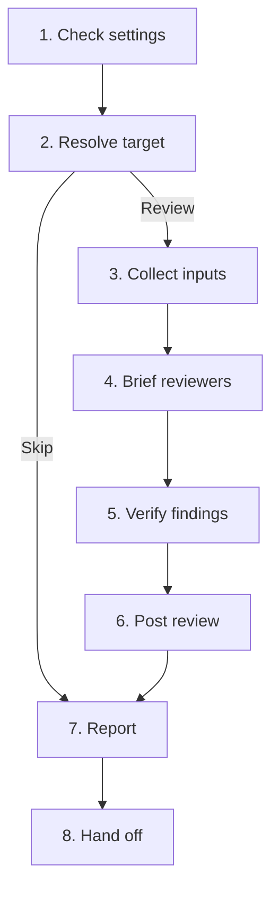

## Dependencies

- **(skill) `orchestrator`** [Must] - Says how to start and brief the reviewers.
- **(cli tool) gh** [Must] - Reads the PR and the issue, and posts the review.
- **(cli tool) git** [Must] - Fetches the PR head commit, or the default branch for the branch diff.

## Args

- **target** [Must] - A PR number, an issue number, or the path of a `SPEC.md` or `DESIGN.md`. An issue number means the spec or design of that issue. With `--local`, the task number, or `-` for XS work.

Ask interactively if any **Must** arg is missing.

## Flags

- **--level** [Optional] - `ultra` or `high`. Sets how many reviewers read a PR diff and which axes each one checks. If absent, the level is `high`. On a spec or design, it is ignored. With `--local`, the level is always `ultra`.
- **--local** [Optional] - Reviews the branch diff against the default branch, before a PR exists. Posts nothing and hands off to nobody: the caller takes the findings. If absent, the target is a PR, a spec or a design.
- **--verify** [Optional] - A PR, or the branch with `--local`. Checks only that the findings of earlier rounds were fixed and that the fixes broke nothing. `--level` is ignored with it. If absent, the run is a full review.
- **--auto** [Optional] - Never ask. At the round limit, take the recommended option. With no target, review the PR of the current branch, and write that assumption under `## Assumptions` in the review body. If absent, ask for a missing target.

## Flow Graph

## Flow steps

1. **Check settings** - If `.sdlc/settings.json` does not exist, say so, print `Next: /setup` as the last line and stop.
2. **Resolve target** - With `--local`, review the branch and skip the rest of this step. Its folder is `<task.path>/<task>/`, or `$(git rev-parse --git-path sdlc/qa)` for `-`. If `gh pr view <target>` finds a PR, review its diff. If not, review the `DESIGN.md` or `SPEC.md` in `<task.path>/<issue>/`. When `spec.storage` is `issue_comment`, read the spec from the issue comment instead. For a path, the issue is the name of its folder. With `--verify` without `--local` and a target that is not a PR, say that `--verify` takes only a PR or `--local` and stop. On a PR without `--verify`, run `git fetch origin pull/<pr>/head`, then count the earlier full reviews from `gh pr view <pr> --json reviews,headRefOid`: the bodies that start with `review.prefix` but not with `<prefix> [verify]`. If the count is `review.max_rounds` (2 when unset) or more, say that the limit is hit and ask what to do. When a review that starts with `<prefix> [verify] pass` is newer than the latest full review and its commit is the head commit, recommend to skip the review: go to step 7 and hand off with `pass`. If not, list the commits after the commit of the latest full review with `git rev-list <its commit>..<head>`, and leave out the ones that change only files in `<task.path>`. When every commit left is named in a fix reply on the PR, recommend to run with `--verify`. If one is not, recommend the full review. Offer the full review as the other option, or `--verify` when the full review is the recommendation. With `--auto`, take the recommended option and say so in the report.
3. **Collect inputs** - Make a temporary folder outside the repository. Save the raw inputs there: the diff from `gh pr diff <pr>`, the body of the issue that the PR closes or that owns the spec, and the spec or design. For a PR, run `git fetch origin pull/<pr>/head` and note the head SHA. Take the guide path from `guides.code_review`. If it is null, the run has no guide. If the PR closes no issue, it is XS work: skip the `criteria` axis and say so in the report. With `--verify` on a PR, save instead `all.json` from `sh .sdlc/scripts/review_threads.sh list <pr> --all` and the head SHA, and skip the issue, the spec and the guide. Save the threads to check as `threads.json`: each thread whose newest reply that is not a `[verify]` reply names a commit SHA, and whose first comment does not mark it `nit` (`nit:` or `[nit]`). The other threads are declined, needs-you or follow-up threads. The fix commits are the SHAs named in the replies after the newest `[verify]` reply of each kept thread, or in all its replies when it has none. Save the threads with `resolved` false as `open.json`. With `--local`, run `git fetch origin <default_branch>`, and save the diff from `git diff origin/<default_branch>...HEAD -- . ':!<task.path>'` and the head SHA from `git rev-parse HEAD` in place of the PR diff and head. The issue is the task. For `-`, it is XS work: skip the `criteria` axis and say so in the report. With `--local --verify`, read the rows of `<folder>/PR.md` whose Decision is `fix`. Save `threads.json` with one item per row, `{id: "<#>", path, line, comments: [{body: "<severity>: <finding>"}, {body: "fixed in <Fix sha>"}]}`, `open.json` as `[]`, and the head SHA, and skip the issue, the spec and the guide. The fix commits are the SHAs in the Fix column.
4. **Brief reviewers** - Read `references/reviewer_brief.md`. Follow `orchestrator` to start reviewers with a fresh context and that brief. For a spec or design, start one. For a PR at `high`, start one with the axes `criteria, guide`. At `ultra`, or with `--local` at any level, start three in one message, one for each axis: `criteria`, `guide` and `consistency`, each with its own findings path. The reviewers only read the repository, so they need no worktree. Drop each axis that the run skips: `criteria` for XS work, `guide` when the run has no guide. Start no reviewer whose axes are all dropped. If no reviewer is left, start none, say in the report that there was nothing to check, and hand off with `pass`. With `--verify`, read `references/verify_brief.md` instead and start one reviewer with it. If no thread is left to check, start none, say in the report that there was nothing to verify, and hand off with `pass`.
5. **Verify findings** - Read each findings file. Take the criteria results from the `criteria` reviewer. Check that each cited file, line and criterion exists. Drop a finding only when its citation does not exist, and say so in the report. On a spec or design, keep the five most severe. With `--verify`, read the results file and check each cited thread, file and line in the same way.
6. **Post review** - On a PR, post one review with `gh api repos/{owner}/{repo}/pulls/<pr>/reviews --input <file>`. Set `event` to `COMMENT` and `commit_id` to the head SHA. Put each finding with a line in the diff as an inline comment. Put the other findings and the criteria table in the review body. Start each comment and the body with `review.prefix`. Put the axis and the severity of each finding after the prefix, for example `:robot: [consistency] should-fix:`. On a spec or design, with `--local`, or when no reviewer started, skip this step. With `--verify`, first reply in each checked thread with `sh .sdlc/scripts/review_threads.sh reply <thread-id> <file>`: `<prefix> [verify] <result>: <path>:<line>`. Then post one review, also when no finding is new. Its body starts with `<prefix> [verify] <pass|fail>`, and each new finding starts with `<prefix> [verify] <severity>:`.
7. **Report** - Give the report from the Output section.
8. **Hand off** - With `--local`, skip this step: the caller takes the findings. If not, run `sh .sdlc/scripts/next_step.sh <pr-or-issue> --after review --result <pass|fail>`, with `--auto` when this run has it. Use `pass` when no finding is left, `fail` when one is. With `--verify`, use `pass` when every thread to check has a result, every result is `fixed` and no blocking or should-fix finding is left. A thread with no result counts as not fixed. Nits do not fail the round. Print its output as the last line.

## Rules

1. Put nothing from this session in the brief: no summary, plan, reasoning or opinion about the change. Give only the paths and numbers that the brief asks for.
2. Do not drop or soften a finding because you disagree with it. A person decides.
3. Advise only. Never approve, request changes, merge, push, edit the code or write a file in the repository.

## Output

- On a PR: one review of type comment, with the findings as inline comments.
- A report: the findings by severity, blocking first, each with its location and evidence. For a diff, also the level and the result of each acceptance criterion, or that the `criteria` axis was skipped. Say if the run had no guide. Give the review link on a PR. With `--local`, give the path of each findings or results file instead. With `--verify`, the result of each checked thread with its line, instead of the criteria.
- The `Next:` line as the last line, except with `--local`.
