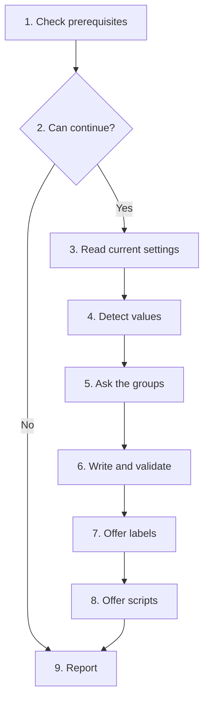

## Dependencies

- **(cli tool) git** [Must] - Reads the repository and its remote.
- **(cli tool) gh** [Must] - Reads the default branch and the labels, and creates labels.
- **(cli tool) jq** [Must] - `validate_settings.sh` reads the settings file with it.

## Flags

- **--auto** [Optional] - Accept every detected value and default, and write the settings file only. If absent, ask each group and each change outside the settings file.

## Flow Graph

## Flow steps

1. **Check prerequisites** - Record each result for the report: `git rev-parse --show-toplevel` (a Git repo), `gh auth status` (an authenticated `gh`), `git remote get-url origin` (the tracker). If `--auto` is passed, read `references/auto_mode.md`.
2. **Can continue?** - If there is no Git repo, go to step 9 and name the cause. If not, go to step 3.
3. **Read current settings** - If `.sdlc/settings.json` exists, run `sh <skill-dir>/scripts/validate_settings.sh`. `<skill-dir>` is the directory of this SKILL.md. Keep every valid value. Each line it prints names a key to ask about. If it prints `valid`, go to step 7.
4. **Detect values** - Read `references/walkthrough.md`. Detect each key that step 3 did not keep.
5. **Ask the groups** - Ask the seven groups in `references/walkthrough.md` in order, one group for each message. Show the detected value or the schema default for each key. Ask only what detection could not answer, and always ask `issue.tracker` unless step 3 kept it. Skip a group that has no key left to ask.
6. **Write and validate** - Show the finished file and get a yes. Write `.sdlc/settings.json`, then run `validate_settings.sh` on it. If it prints errors, fix each named key and validate again.
7. **Offer labels** - Find the missing labels as `references/trackers.md` says for `issue.tracker`. If any are missing, ask yes or no. On yes, create them as it says.
8. **Offer scripts** - Ask yes or no. On yes, run `sh <skill-dir>/scripts/install.sh <repo-root>`. If it prints `kept` lines, list those templates and ask whether to keep them or override them. On override, run it again with `--override`.
9. **Report** - Give the report from the Output section. If `.sdlc/scripts/next_step.sh` exists, run `sh .sdlc/scripts/next_step.sh - --after setup`, with `--auto` when it was passed, and print its output as the last line. If not, read `references/harness.md` and print the fallback `Next:` line for the current harness.

## Rules

1. Never change, drop or ask again about a value that is in the settings file and valid. A kept tracker and its mapping stay as they are.
2. Take keys, allowed values and defaults only from `assets/settings.schema.json`.
3. Set a guide with no file to `null`. Never create a guide file.
4. Change nothing outside `.sdlc/settings.json` without a yes for that step.
5. Leave every change uncommitted.

## Output

- `.sdlc/settings.json`, and, when accepted, the labels, `.sdlc/scripts/` and `.sdlc/templates/`.
- A report: each prerequisite and its result (Git repo, `gh` login, tracker, whether a tool for a Jira or Linear tracker is connected, and whether the `research.engine` tool is connected), each key as kept, detected, default or chosen, each offer as done, declined, left to do or not available for the tracker, and the `Next:` line last.
