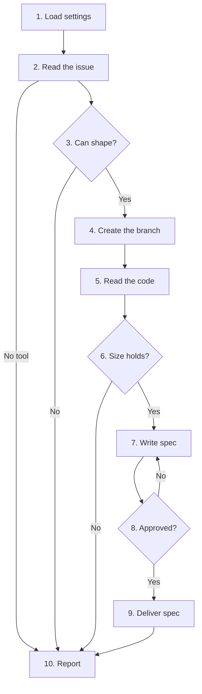

## Args

- **issue** [Must] - Number or key of a `ready` task.

Ask interactively if any **Must** arg is missing.

## Flags

- **--auto** [Optional] - Write, verify, apply blocking findings, and deliver the spec without asking. If absent, stop for approval when `spec.review` is `manual`.

## Flow Graph

## Flow steps

1. **Load settings** - If `.sdlc/settings.json` or `.sdlc/scripts/` does not exist, stop and print `Next: /setup` as the last line. Read `default_branch`, `issue.*`, `specs.*` (fallback `.sdlc/specs`, `pr`), `work.path` (fallback `.sdlc/work`), `spec.*`, `sizing.*`, `templates.spec`, and `guides.development`. If `guides.development` is `null`, say that you run without one. Read `references/tracker_github.md`, `references/tracker_jira.md`, or `references/tracker_linear.md` for `issue.tracker`. If `--auto` is passed, read `references/auto_mode.md`.
2. **Read the issue** - Read the issue with its title, body, labels, parent and sub-issues, as the tracker reference says. Read the parent story and its design (under `specs.path` or the legacy task folder), if there is one.
3. **Can shape?** - If the issue is not a task at the `ready` stage (if it is a story, tell the user to run `design` for an L story or `slice` for an M story), go to step 10 and name the cause. If not, go to step 4.
4. **Create the branch** - Read `references/delivery.md`. When `specs.delivery` is `pr`, or `spec.storage` is `local` or `both`, fetch `origin <default_branch>` and switch to `spec/<issue>-<slug>` from `origin/<default_branch>` (or create it).
5. **Read the code** - Read the code that the work touches. Count the exact modules, files and changed lines. When a decision needs an outside fact that the code cannot give, run the `research` skill with that one question.
6. **Size holds?** - Read `references/resize.md`. If a trigger in it holds, raise the size as it says and go to step 10. If not, go to step 7.
7. **Write spec** - Read `references/spec.md` and write `<specs.path>/<issue>-<slug>.md` from `templates.spec` (or `assets/templates/spec.md` if missing, and note that in the report), storing it as `references/delivery.md` and `spec.storage` say.
8. **Approved?** - If `spec.review` is `auto` (or `--auto` is passed when `spec.review` is not `pr`), run `verify-spec` on the spec and apply each blocking finding. If `spec.review` is `manual`, show the spec to the person; if changes are requested, go to step 7. If approved, `spec.review` is `off`, or `spec.review` is `pr` (reviewed on the Spec PR), go to step 9.
9. **Deliver spec** - Follow `references/delivery.md`: when `specs.delivery` is `pr`, commit `<specs.path>/<issue>-<slug>.md`, push `spec/<issue>-<slug>`, and open a Spec PR (`Spec for #<issue>`); leave the task `ready` until merge. When `specs.delivery` is `direct`, commit the file (if `local` or `both`), post or update the `## SPEC.md` comment (if `issue_comment` or `both`), and set the stage to `shaped` as the tracker reference says.
10. **Report** - Give the report from the Output section. Run `sh .sdlc/scripts/next_step.sh <issue> --after shape` (with `--auto` when passed, and `--result fail` after a stop in step 2, 3, or 6) if supported and print its output last; if `next_step.sh` does not yet handle Spec PRs, print `Next: /sdlc:verify-spec <pr>` for a Spec PR or `Next: /sdlc:build <issue>` when `shaped`.

## Rules

1. Never restate requirements. Link to the issue and the story.
2. Never use `Closes #<issue>`, `Fixes #<issue>`, or `Resolves #<issue>` in a Spec PR body; use `Spec for #<issue>`.

## Output

- `<specs.path>/<issue>-<slug>.md` (and the Spec PR link when `specs.delivery` is `pr`, or task `shaped` when `direct`), verification findings, the size line (confirmed or raised, with the signal that changed), and the `Next:` line last.
