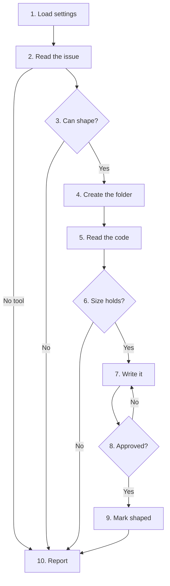

## Args

- **issue** [Must] - Number or key of a `ready` task.

Ask interactively if any **Must** arg is missing.

## Flags

- **--auto** [Optional] - Write, review, apply the blocking findings and mark it `shaped` without asking. If absent, stop for approval when `spec.review` is not `off`.

## Flow Graph

## Flow steps

1. **Load settings** - If `.sdlc/settings.json` or `.sdlc/scripts/` does not exist, stop and print `Next: /setup` as the last line. Read `issue.*`, `task.path`, `spec.*`, `sizing.*`, `templates.spec` and the `guides.development` file. If the guide is `null`, say that you run without one. Read the reference for `issue.tracker`: `references/tracker_github.md`, `references/tracker_jira.md` or `references/tracker_linear.md`. If `--auto` is passed, read `references/auto_mode.md`.
2. **Read the issue** - Read the issue with its title, body, labels, parent and sub-issues, as the tracker reference says. Read the parent story and its design (under `specs.path` or the legacy task folder), if there is one.
3. **Can shape?** - If the issue is not a task at the `ready` stage (if it is a story, tell the user to run `design` for an L story or `slice` for an M story), go to step 10 and name the cause. If not, go to step 4.
4. **Create the folder** - Read `references/task_folder.md` and create the branch and the folder.
5. **Read the code** - Read the code that the work touches. Count the exact modules, files and changed lines. When a decision needs an outside fact that the code cannot give, run the `research` skill with that one question.
6. **Size holds?** - Read `references/resize.md`. If a trigger in it holds, raise the size as it says and go to step 10. If not, go to step 7.
7. **Write it** - Read `references/spec.md` and write the file. Store it as `spec.storage` says (`references/task_folder.md`).
8. **Approved?** - If `spec.review` is `auto`, run the `review` skill on the file and apply each blocking finding. If it is `manual`, show the file to the person. If the person asks for changes, go to step 7. If the person approves, or `spec.review` is `off`, go to step 9.
9. **Mark shaped** - Commit the task folder. Set the stage to `shaped` as the tracker reference says.
10. **Report** - Give the report from the Output section. Then run `sh .sdlc/scripts/next_step.sh <issue> --after shape`, with `--auto` when it was passed, and print its output as the last line. Add `--result fail` after a stop in step 2, 3 or 6.

## Rules

1. Never restate requirements. Link to the issue and the story.

## Output

- `SPEC.md` as `spec.storage` says, the issue `shaped`, and a report: the size line (confirmed or raised, with the signal that changed), the file, the review findings, and the `Next:` line last.
