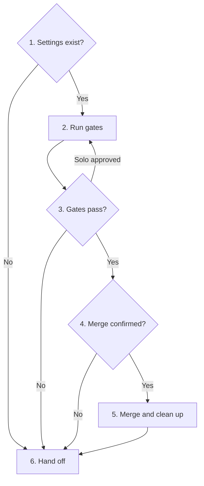

## Dependencies

- **(cli tool) git** [Must] - Deletes the branch and worktree. `on_merge.sh` uses it to make the cleanup PR.
- **(cli tool) gh** [Must] - GitHub official CLI. Reads the gates and merges the PR.
- **(cli tool) jq** [Must] - `ship_gates.sh` reads the PR and the settings with it.

## Args

- **pr** [Optional] - Number of the pull request. Default: the PR of the current branch.

## Flags

- **--auto** [Optional] - Merge without a typed confirmation, and record that on the issue. If absent, ask the person to confirm the merge.

## Flow Graph

## Flow steps

1. **Settings exist?** - If `.sdlc/settings.json` exists, read `review.prefix` (fallback `:robot:`) and go to step 2. If not, stop and print `Next: /setup` as the last line.
2. **Run gates** - Get the PR with `gh pr view [pr] --json number,headRefName,body,closingIssuesReferences,author` and inspect `gh pr diff <pr> --name-only`. Fast-forward the PR branch to the PR head and do not push local commits. From the repository root, run `sh .sdlc/scripts/ship_gates.sh <pr>` and show its output.
3. **Gates pass?** - If the exit code is 0, go to step 4. If `approval` is the only failed gate, its line reads `approval: fail - no solo approval from <author>`, and `--auto` is absent, ask the maintainer in chat to approve PR `#<pr>`: on yes, post `<review.prefix> [approval] approved in chat by @<author>` with `gh pr comment <pr> --body "<review.prefix> [approval] approved in chat by @<author>"` (where `<author>` is the PR author login from step 2) and go back to step 2; on no, name the failed approval gate and go to step 6 with result `fail`. For any other failure, name each failed gate and who can clear it, then go to step 6 with result `fail`.
4. **Merge confirmed?** - Choose the first merge method that `gh repo view --json squashMergeAllowed,mergeCommitAllowed,rebaseMergeAllowed` allows, in that order. Without `--auto`, show the gate lines and the method, and ask the person to type `merge`. Any other answer goes to step 6 with result `fail`. With `--auto`, do not ask. Comment on the issue, or on the PR when it closes no issue, under `## Assumptions`: merged without a typed confirmation, and the method you chose.
5. **Merge and clean up** - Run `gh pr merge <pr> --<method> --match-head-commit <head>`, where `<head>` is `git rev-parse HEAD`; do not push to the PR branch before the merge. If `.github/workflows/sdlc-on-merge.yml` does not exist, run `sh .sdlc/scripts/on_merge.sh <pr>` from the repository root. After the merge, `on_merge.sh` (from the workflow or this step) sets the issue stage and, for a Code PR that changes more than `<specs.path>/`, opens one cleanup PR `sdlc/<issue>-cleanup` per closed issue into the base branch: it applies `specs.on_ship` to `<specs.path>/<issue>-*.md` (excluding `*-design.md` and `<specs.archive_path>/`) and removes `<task.path>/<issue>/` when `task.keep` is `false`, with the trailer `SDLC-Spec-Archive: true`. Show its output. When the workflow is installed, the action opens the cleanup PR after this skill ends: say so in the report, and that if the action run fails (for example because the repository setting "Allow GitHub Actions to create and approve pull requests" is off), running `sh .sdlc/scripts/on_merge.sh <pr>` locally is safe and opens the missing cleanup PR. Delete the remote branch with `git push origin --delete <branch>`. A branch that the repository already deleted is not an error. Remove the worktree of the branch and the local branch. If this session runs inside that worktree, read `references/harness.md` first.
6. **Hand off** - Give the report from the Output section. Run `sh .sdlc/scripts/next_step.sh <pr> --after ship --result <pass|fail>`, with `--auto` if the flag is passed. Print its output as the last line.

## Rules

1. Never merge without a person's approval on the PR (a non-author person's GitHub approval, or in a solo-maintainer repository the PR author's approval comment on the PR). `--auto` removes the merge confirmation, not a gate.
2. Do not approve the PR, dismiss a review or resolve a thread yourself to make a gate pass; in a solo-maintainer repository, post the chat approval comment only after the maintainer explicitly approves in chat (step 3).
3. Do not merge with `--admin`, and do not pass this skill's `--auto` to `gh pr merge`.

## Output

- The merged PR, with the approved head merged untouched. On a Code PR with `specs.on_ship` set to `archive` (default) or `delete`, or `task.keep` set to `false`, a cleanup PR `sdlc/<issue>-cleanup` per closed issue that moves the task spec to `<specs.archive_path>/` or removes it (and the task folder) with `SDLC-Spec-Archive: true`, by the on-merge action or by `on_merge.sh`. The on-merge action can open it only when the repository setting "Allow GitHub Actions to create and approve pull requests" is on; when it is off, the action fails after setting the stage. A cleanup PR opened by the action starts no CI.
- The issue at `done` (or `shaped` for a Spec/Design PR), by the on-merge action or by `on_merge.sh`.
- A report: the gate lines, the merge commit, and the cleanup PR (or why none was opened, or that the on-merge action opens it and `on_merge.sh <pr>` recovers a failed run).
- The `Next:` line as the last line.
