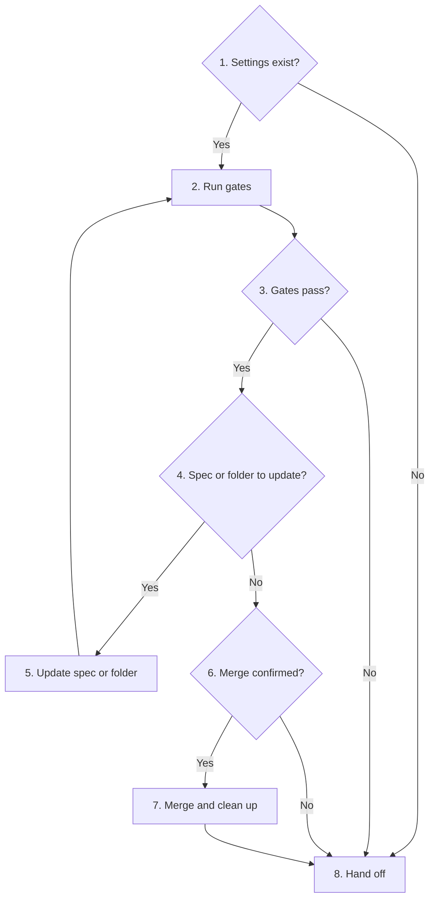

## Dependencies

- **(cli tool) git** [Must] - Moves or removes the task spec per `specs.on_ship` and deletes the branch and worktree.
- **(cli tool) gh** [Must] - GitHub official CLI. Reads the gates and merges the PR.
- **(cli tool) jq** [Must] - `ship_gates.sh` reads the PR and the settings with it.

## Args

- **pr** [Optional] - Number of the pull request. Default: the PR of the current branch.

## Flags

- **--auto** [Optional] - Merge without a typed confirmation, and record that on the issue. If absent, ask the person to confirm the merge.

## Flow Graph

## Flow steps

1. **Settings exist?** - If `.sdlc/settings.json` exists, read `specs.path` (fallback `.sdlc/specs`), `specs.archive_path` (fallback `.sdlc/specs/archived`), `specs.on_ship` (fallback `archive`), `task.path` (fallback `.sdlc/task`), and `task.keep` (fallback `true`), and go to step 2. If not, stop and print `Next: /setup` as the last line.
2. **Run gates** - Get the PR with `gh pr view [pr] --json number,headRefName,body,closingIssuesReferences` and inspect `gh pr diff <pr> --name-only`. Fast-forward the PR branch to the PR head and do not push local commits. From the repository root, run `sh .sdlc/scripts/ship_gates.sh <pr>` and show its output.
3. **Gates pass?** - If the exit code is 0, go to step 4. If not, name each failed gate and who can clear it, then go to step 8 with result `fail`.
4. **Spec or folder to update?** - Skip on Spec/Design-only PRs (every changed file in `gh pr diff <pr> --name-only` is under `<specs.path>/`, or `closingIssuesReferences` is empty with `Spec for #<id>` / `Design for #<id>` in the PR body). On a Code PR closing `<issue>`, check for a task spec `<specs.path>/<issue>-*.md` (excluding `*-design.md` and `<specs.archive_path>/`) when `specs.on_ship` is `archive` or `delete`, or a legacy `<task.path>/<issue>/` folder when `task.keep` is `false`. If any applies, go to step 5. If not, go to step 6.
5. **Update spec or folder** - Apply `specs.on_ship` to the matching task spec: for `archive`, run `mkdir -p <specs.archive_path>` and `git mv <spec> <specs.archive_path>/`; for `delete`, run `git rm <spec>`. If `task.keep` is `false` and `<task.path>/<issue>/` exists, remove it with `git rm -r <task.path>/<issue>/`. Commit the change with trailer `SDLC-Spec-Archive: true`, push to the PR branch, wait with `gh pr checks <pr> --watch`, and go to step 2.
6. **Merge confirmed?** - Choose the first merge method that `gh repo view --json squashMergeAllowed,mergeCommitAllowed,rebaseMergeAllowed` allows, in that order. Without `--auto`, show the gate lines and the method, and ask the person to type `merge`. Any other answer goes to step 8 with result `fail`. With `--auto`, do not ask. Comment on the issue, or on the PR when it closes no issue, under `## Assumptions`: merged without a typed confirmation, and the method you chose.
7. **Merge and clean up** - Run `gh pr merge <pr> --<method> --match-head-commit <head>`, where `<head>` is `git rev-parse HEAD`. If `.github/workflows/sdlc-on-merge.yml` does not exist, run `sh .sdlc/scripts/on_merge.sh <pr>`. Delete the remote branch with `git push origin --delete <branch>`. A branch that the repository already deleted is not an error. Remove the worktree of the branch and the local branch. If this session runs inside that worktree, read `references/harness.md` first.
8. **Hand off** - Give the report from the Output section. Run `sh .sdlc/scripts/next_step.sh <pr> --after ship --result <pass|fail>`, with `--auto` if the flag is passed. Print its output as the last line.

## Rules

1. Never merge without a person's approval on the PR. `--auto` removes the question, not a gate.
2. Do not approve the PR, dismiss a review or resolve a thread yourself to make a gate pass.
3. Do not merge with `--admin`, and do not pass this skill's `--auto` to `gh pr merge`.

## Output

- The merged PR. On a Code PR with `specs.on_ship` set to `archive` (default) or `delete`, the PR also moves the task spec to `<specs.archive_path>/` or removes it with `SDLC-Spec-Archive: true`.
- The issue at `done` (or `shaped` for a Spec/Design PR), by the on-merge action or by `on_merge.sh`.
- A report: the gate lines, the merge commit, and what was cleaned up.
- The `Next:` line as the last line.
