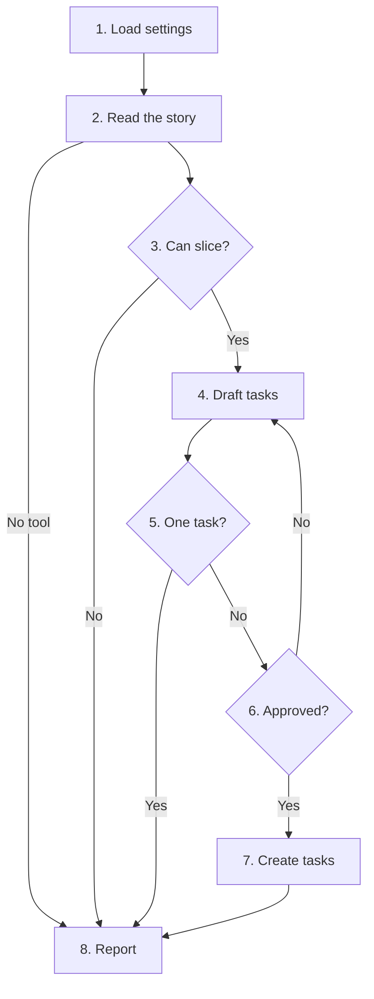

## Args

- **story** [Must] - Number or key of the `ready` story issue.

Ask interactively if any **Must** arg is missing.

## Flags

- **--auto** [Optional] - Create the tasks without confirming the breakdown. If absent, stop for approval of the breakdown.

## Flow Graph

## Flow steps

1. **Load settings** - If `.sdlc/settings.json` or `.sdlc/scripts/` does not exist, stop and print `Next: /setup` as the last line. Read `task.path`, `spec.storage`, `sizing.m_max_tasks`, `templates.task` and the `guides.labeling` file. If the guide is `null`, say that you run without one. Read the reference for `issue.tracker`: `references/tracker_github.md`, `references/tracker_jira.md` or `references/tracker_linear.md`. If `--auto` is passed, read `references/auto_mode.md`.
2. **Read the story** - Read the story with its title, body, labels and comments, as the tracker reference says. Read the design if there is one: `<task.path>/<story>/DESIGN.md` in the working tree or on the story's branch (`git show <story>-<slug>:<path>`), or the design comment on the story.
3. **Can slice?** - An L story needs the `shaped` label and a design. Any other story needs the `ready` label. If the story fails its check, go to step 8 and name the cause. If not, go to step 4.
4. **Draft tasks** - Read `references/slicing.md` and draft the tasks with their blocking edges.
5. **One task?** - If the breakdown has one task, the story is an S. Set the size of the story to S as the tracker reference says, create no task, and go to step 8. If not, go to step 6.
6. **Approved?** - Show the breakdown: each task's title, goal, criteria and blockers. If the person changes it, go to step 4. If the person approves, go to step 7.
7. **Create tasks** - Create the tasks under the story in blocking order, so that each blocker exists first, each with its blocking links. Add the labels that the labeling guide asks for. Set the stage of each task to `ready`. Do each of these as the tracker reference says.
8. **Report** - Give the report from the Output section. Then run `sh .sdlc/scripts/next_step.sh <ref> --after slice`, with `--auto` when it was passed, and print its output as the last line. `<ref>` is the first task with no blocker, the story after step 5, or `<story> --result fail` after a stop in step 2 or 3.

## Rules

1. Never write how to build a task. That is the spec, and `shape` writes it when the task is picked up.
2. Put each acceptance criterion of the story in exactly one task.

## Output

- Task sub-issues of the story, `ready`, with native blocking links, and a report: each task with its blockers, any re-size with its reason, and the `Next:` line last.
