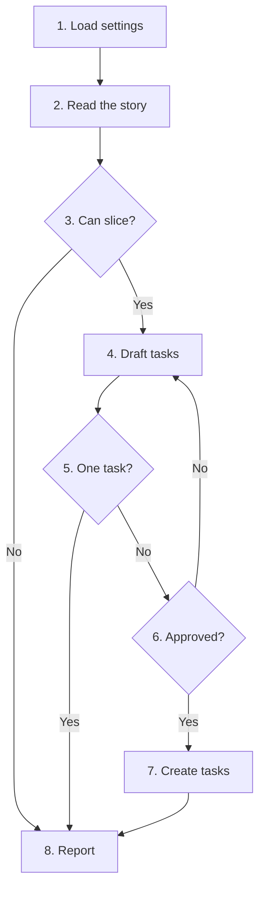

## Args

- **story** [Must] - Number of the `ready` story issue.

Ask interactively if any **Must** arg is missing.

## Flags

- **--auto** [Optional] - Create the tasks without confirming the breakdown. If absent, stop for approval of the breakdown.

## Flow Graph

## Flow steps

1. **Load settings** - If `.sdlc/settings.json` or `.sdlc/scripts/` does not exist, stop and print `Next: /setup` as the last line. Read `task.path`, `spec.storage`, `sizing.m_max_tasks` and the `guides.labeling` file. If the guide is `null`, say that you run without one. If `--auto` is passed, read `references/auto_mode.md`.
2. **Read the story** - Run `gh issue view <story> --json title,body,labels,comments`. Read the design if there is one: `<task.path>/<story>/DESIGN.md`, or the design comment on the story when `spec.storage` is `issue_comment`.
3. **Can slice?** - If the story does not have the `ready` label, or it has `size:L` and no design, go to step 8 and name the cause. If not, go to step 4.
4. **Draft tasks** - Read `references/slicing.md` and draft the tasks with their blocking edges.
5. **One task?** - If the breakdown has one task, the story is an S. Run `python3 .sdlc/scripts/size.py <story> S`, create no task, and go to step 8. If not, go to step 6.
6. **Approved?** - Show the breakdown: each task's title, goal, criteria and blockers. If the person changes it, go to step 4. If the person approves, go to step 7.
7. **Create tasks** - Create the tasks in blocking order, so that each blocker exists first: `gh issue create --parent <story> --blocked-by <numbers>`. Add the labels that the labeling guide asks for. Run `python3 .sdlc/scripts/stage.py <task> ready` on each task.
8. **Report** - Give the report from the Output section. Then run `python3 .sdlc/scripts/next_step.py <ref> --after slice`, with `--auto` when it was passed, and print its output as the last line. `<ref>` is the first task with no blocker, the story after step 5, or `<story> --result fail` after step 3.

## Rules

1. Never write how to build a task. That is the spec, and `shape` writes it when the task is picked up.
2. Put each acceptance criterion of the story in exactly one task.

## Output

- Task sub-issues of the story, `ready`, with native blocking links, and a report: each task with its blockers, any re-size with its reason, and the `Next:` line last.
