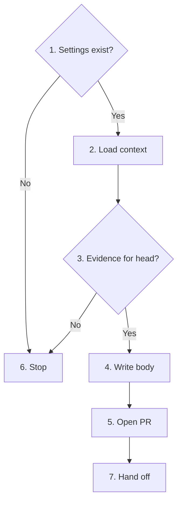

## Dependencies

- **(cli tool) git** [Must] - Reads the branch and pushes it.
- **(cli tool) gh** [Must] - Reads the issue and opens the pull request.

## Args

- **task** [Optional] - Issue number of the task. Default: none, for XS work, which has no issue and no task folder.

## Flags

- **--auto** [Optional] - Adds `--auto` to the `Next:` line. The run asks nothing in either mode.

## Flow Graph

## Flow steps

1. **Settings exist?** - If `.sdlc/settings.json` exists, go to step 2. If not, go to step 6.
2. **Load context** - Read the settings. The task folder is `<task.path>/<task>/`. For XS work it is `$(git rev-parse --git-path sdlc/qa)`. Read the issue with `gh issue view <task>`, and the branch with `git log` and `git diff` against `<default_branch>`.
3. **Evidence for head?** - Run `sh .sdlc/scripts/qa_check.sh <task-folder>`. If it exits 0, go to step 4. If not, go to step 6.
4. **Write body** - Fill `assets/pr_body.md`. Take the evidence from the newest run in `QA.md`. Leave out `Closes #<task>` for XS work.
5. **Open PR** - Run `git push -u origin HEAD`. Run `gh pr create --base <default_branch>` with an imperative title and the body. Then run `sh .sdlc/scripts/stage.sh <task> review`, except for XS work. Go to step 7.
6. **Stop** - Open no PR. Say why: no settings, or the reason that `qa_check.sh` printed. Print `Next: /setup` when the settings are missing. If not, run `sh .sdlc/scripts/next_step.sh <task or -> --after submit --result fail`, with `--auto` when this run has it, and print its output as the last line.
7. **Hand off** - Run `sh .sdlc/scripts/next_step.sh <pr> --after submit`, with `--auto` when this run has it. Print its output as the last line.

## Rules

1. Never open a PR when `qa_check.sh` fails. Do not run `prove`, edit `QA.md` or move HEAD to get past the check.
2. Claim only checks that the newest run in `QA.md` holds.
3. Call a change hard to reverse when it transforms or drops data. Do the same when it has an effect outside the system, such as an email, a payment or a call to a third party.
4. A text visual goes in the body. `gh` cannot attach a screenshot, so name the screen a person must add.
5. Write each assumption under the `## Assumptions` heading of the body.
