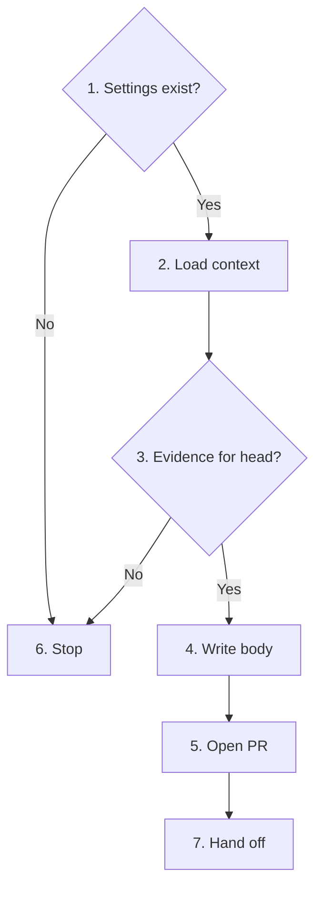

## Dependencies

- **(cli tool) git** [Must] - Reads the branch, checks for clean diff, and pushes it.
- **(cli tool) gh** [Must] - Reads the issue and opens the pull request.

## Args

- **task** [Optional] - Issue number of the task. Default: none, for XS work, which has no issue.

## Flags

- **--auto** [Optional] - Adds `--auto` to the `Next:` line. The run asks nothing in either mode.

## Flow Graph

## Flow steps

1. **Settings exist?** - If `.sdlc/settings.json` exists, go to step 2. If not, go to step 6.
2. **Load context** - Read `default_branch`, `work.path` (fallback `.sdlc/work`), `specs.path` (fallback `.sdlc/specs`), `specs.archive_path` (fallback `.sdlc/specs/archived`), and `task.path` (fallback `.sdlc/task`) from `.sdlc/settings.json`. The work folder is `<work.path>/<task>/`, or `<work.path>/xs/` for XS work. Find the merged spec at `<specs.path>/<task>-*.md` (excluding `*-design.md` and `<specs.archive_path>/`, fallback `<task.path>/<task>/SPEC.md`). Read the issue with `gh issue view <task>`, and inspect `git log` and `git diff --name-only origin/<default_branch>...HEAD` plus `git status --porcelain`.
3. **Evidence for head?** - Verify that zero files under `<work.path>/` (or `self-review.md` / `self-qa.md`) appear in `git diff --name-only origin/<default_branch>...HEAD` or staged changes, then run `sh .sdlc/scripts/qa_check.sh <work-folder>`. If the diff is clean of ephemeral work files and `qa_check.sh` exits 0, go to step 4. If not, go to step 6.
4. **Write body** - Fill `assets/pr_body.md` in a temporary file outside the repository (never commit it). Take the evidence from the newest run in `<work-folder>/self-qa.md`. Include `Spec: <spec-path>` when a spec file exists, and leave out `Closes #<task>` for XS work.
5. **Open PR** - Run `git push -u origin HEAD`. Run `gh pr create --base <default_branch> --body-file <tmp-file>` with an imperative title. Then run `sh .sdlc/scripts/stage.sh <task> review`, except for XS work. Go to step 7.
6. **Stop** - Open no PR. Say why: no settings, tracked/committed ephemeral files under `<work.path>/`, or the reason that `qa_check.sh` printed. Print `Next: /setup` when the settings are missing. If ephemeral files under `<work.path>/` are tracked or committed, print `Next: remove <work.path>/ files from git, then run /sdlc:submit <task>` (omitting `<task>` for XS, using `$submit` in Codex, with `--auto` when passed). If not, run `sh .sdlc/scripts/next_step.sh <task or -> --after submit --result fail`, with `--auto` when this run has it, and print its output as the last line.
7. **Hand off** - Run `sh .sdlc/scripts/next_step.sh <pr> --after submit`, with `--auto` when this run has it. Print its output as the last line.

## Rules

1. Never open a PR when `qa_check.sh` fails or when files under `<work.path>/` are tracked or committed in the branch diff. Do not run `prove`, edit `self-qa.md`, or move HEAD to get past the check.
2. Claim only checks that the newest run in `self-qa.md` holds.
3. Call a change hard to reverse when it transforms or drops data. Do the same when it has an effect outside the system, such as an email, a payment or a call to a third party.
4. A text visual goes in the body. `gh` cannot attach a screenshot, so name the screen a person must add.
5. Write each assumption under the `## Assumptions` heading of the body.
