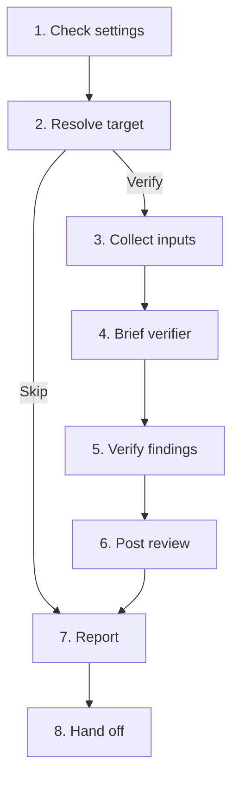

## Dependencies

- **(skill) `orchestrator`** [Must] - Says how to start and brief the verifier subagent.
- **(cli tool) gh** [Must] - Reads the PR and issue, and posts the PR review.
- **(cli tool) git** [Must] - Fetches the PR head commit and resolves the local HEAD SHA.

## Args

- **target** [Must] - A Spec or Design PR number, an issue number, or the path to a spec or design file.

Ask interactively if any **Must** arg is missing.

## Flags

- **--local** [Optional] - Verify the spec or design file locally without looking up or posting to a PR. If absent, resolve a PR first when `<target>` matches one.
- **--auto** [Optional] - Never ask. With no target and no `--local`, verify the PR of the current branch. At the round limit, re-run only when commits landed after the latest `[spec]` review, else skip to step 7. If absent, ask for a missing target or at the round limit.

## Flow Graph

## Flow steps

1. **Check settings** - If `.sdlc/settings.json` does not exist, say so, print `Next: /setup` as the last line and stop. Read `default_branch`, `specs.path` (fallback `.sdlc/specs`), `task.path` (fallback `.sdlc/task`), `spec.storage` (default `local`), `review.prefix` (default `:robot:`), `review.max_rounds` (default `2`), and `guides.development` (if `null`, note that no development guide is set).
2. **Resolve target** - If `--local` is absent and `gh pr view <target>` (or the current branch PR when `--auto` has no target) finds a PR, fetch `origin pull/<pr>/head` and read `gh pr view <pr> --json reviews,headRefOid`. Count earlier reviews whose body starts with `<review.prefix> [spec]`. If the count is `review.max_rounds` or more, say so and ask whether to verify again or skip (with `--auto`, skip to step 7 unless commits landed after the latest `[spec]` review). Otherwise go to step 3. If no PR matches or `--local` is set, resolve a local spec or design: for a file path, verify it exists and extract the issue number from a leading `<id>-` filename or `Task: #<id>` / `Story: #<id>`; for an issue number, look up `<specs.path>/<issue>-*-design.md` or `<specs.path>/<issue>-*.md`, falling back to `<task.path>/<issue>/DESIGN.md` or `SPEC.md`, or to the issue comment starting with `## DESIGN.md` or `## SPEC.md` when `spec.storage` is `issue_comment`.
3. **Collect inputs** - Make a temporary folder outside the repository. On a PR, save the diff from `gh pr diff <pr>`, the head SHA, and the spec or design path changed in the PR. Read the PR body (`gh pr view <pr> --json body,closingIssuesReferences`) and extract the linked issue from `Spec for #<id>` or `Design for #<id>`, falling back to `closingIssuesReferences`. On a local target, note the local spec or design path and `git rev-parse HEAD`. For both modes, save the issue body from `gh issue view <issue> --json title,body,labels,parent`, and if it is a task with a parent story, include the parent story's design path (`<specs.path>/<story>-*-design.md`, fallback `<task.path>/<story>/DESIGN.md`) when it exists.
4. **Brief verifier** - Read `references/spec_brief.md`. Follow `orchestrator` to start one fresh-context subagent with that brief and the collected paths and SHAs.
5. **Verify findings** - Read the findings JSON file. Check that every cited `path` and `line` in the spec or design exists. Drop a finding only when its citation does not exist, and say so in the report. Keep at most the five most severe findings (`blocking` first, then `should-fix`, then `nit`).
6. **Post review** - On a PR, post one review with `gh api repos/{owner}/{repo}/pulls/<pr>/reviews --input <file>`. Set `event` to `COMMENT` and `commit_id` to the head SHA. Put each finding with a line inside the PR diff as an inline comment starting with `<review.prefix> [spec] <severity>:`. Put the remaining findings and the five-question summary in the review body, starting with `<review.prefix> [spec]`. On a local target, skip this step and post nothing.
7. **Report** - Give the report from the Output section.
8. **Hand off** - On a local target, skip this step: the caller takes the findings. On a PR, run `sh .sdlc/scripts/next_step.sh <pr> --after verify-spec --result <pass|fail>`, with `--auto` when passed, using `pass` when no `blocking` or `should-fix` finding remains and `fail` otherwise. Print its output as the last line.

## Rules

1. Put nothing from this session in the brief: no summary, plan, reasoning or opinion about the spec or design. Give only the paths and numbers that the brief asks for.
2. Do not drop or soften a finding because you disagree with it. A person decides.
3. Advise only. Never approve, request changes, merge, push, edit the spec or write a file in the repository.

## Output

- On a PR: one comment review starting with `<review.prefix> [spec]` with inline diff comments.
- A report: the findings by severity, blocking first, each with its location and evidence, plus the five-question summary and the path of the findings file (and the review link on a PR).
- The `Next:` line as the last line on a PR target.
